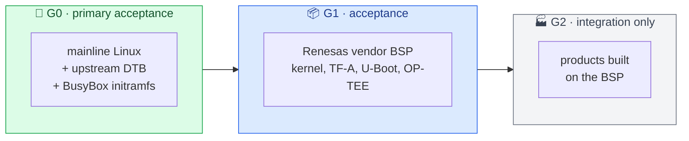
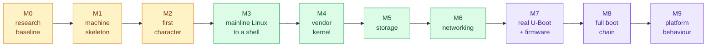

# 🖥️ qemu-rzv2l

**A QEMU machine model of the Renesas RZ/V2L SMARC EVK, built to run the board's real software, unmodified.**


[](https://github.com/umair-as/qemu/actions/workflows/rzv2l.yml?query=branch%3Arzv2l-dev)

---

## ✨ What this is

The RZ/V2L is a Renesas SoC with two Arm Cortex-A55 cores, a GIC-600 interrupt controller and 2 GB of DDR4 on its evaluation kit. This project adds a machine for it to QEMU, so that software built for the physical board boots in emulation **without changes to that software**:

- 🐧 **mainline Linux** with the upstream device tree
- 📦 **the Renesas vendor BSP** kernel and userspace
- 🔐 later, **the vendor firmware chain**: Trusted Firmware-A, OP-TEE and U-Boot

The point is not a machine that merely boots. It is a machine whose devices behave the way the silicon does, so the emulator can be trusted for development, CI and debugging when the board is not at hand.

## 🎯 Principles

| | Principle | In practice |
|---|---|---|
| 🔎 | **Evidence before implementation** | Every device behaviour traces to the hardware manual, the guest code that depends on it, and measurements on a physical EVK. |
| 🚫 | **Never modify the guest** | No device-tree edits, driver patches or invented boot arguments. Anything the model cannot satisfy is recorded as a fidelity gap. |
| ⚖️ | **Never silently wrong** | A device either behaves as the hardware does, or fails in a way the guest can see. |
| 🧪 | **Booting is not proof** | Device models are verified by tests that assert hardware-manual values (reset values, ID registers), and each test is checked to fail when the model is broken. |
| 🔁 | **Two start states** | Devices start either at the manual's power-on reset values (firmware boot) or at the state the firmware leaves behind, as measured on the board (direct kernel boot). |

## 🧩 Software it targets



**G = guest tier**: what QEMU runs, and how much it counts for acceptance. G0 and G1 are built or fetched by this project and pinned; G2 is never a dependency. Defined in [specification](docs/spec/project.md) §2.

## 🗺️ Roadmap



🟧 bring-up · 🟩 Linux · 🟪 firmware and platform. **Where it stands:** ✅ M0-M6: mainline Linux and Renesas's own kernel boot to a shell on both CPUs, from an ext4 root on the SD card, with Gigabit Ethernet. ✅ M7: the board's TF-A BL31, OP-TEE and U-Boot boot Linux from the card, Linux calls a trusted application in OP-TEE, and U-Boot and Linux read and write the module's QSPI flash (release `rzv2l-v1.1`). ⏭️ M8: the board's BL2 from the flash. **To run each milestone yourself, follow the [walkthrough](docs/walkthrough.md).** Progress, units and blocks: [Milestones](docs/milestones.md). Exit criteria: the [specification](docs/spec/project.md).

## 🚀 Building

```bash
git clone --recurse-submodules https://github.com/umair-as/rzv2l-qemu.git
cd rzv2l-qemu
mkdir -p build/qemu && cd build/qemu
../../qemu/configure --target-list=aarch64-softmmu --disable-docs
ninja qemu-system-aarch64
```

Rebuilding, running the tests, style checks, tracing and editor setup: [Building and testing by hand](docs/learning/building-and-testing.md).

> [!NOTE]
> The `rzv2l-smarc` machine boots mainline Linux and Renesas's kernel to a BusyBox shell on the serial console, with an SD card if you give it one. Ethernet, I2C and USB are stubs for now, so their drivers fail at boot; [Milestones](docs/milestones.md) shows what is modelled.

Next: build the guests and run each milestone with the [walkthrough](docs/walkthrough.md).

The QEMU port lives in a fork, included as the `qemu/` submodule. It carries only code in the shape upstream QEMU would accept; the specification, research, evidence and tests live in this repository.

## 📚 Documentation

| | Document | What it holds |
|---|---|---|
| 🚶 | [Walkthrough](docs/walkthrough.md) | **start here:** build, then run M1, M2, … yourself, with what you should see |
| 🏁 | [Milestones](docs/milestones.md) | progress: what is done, what comes next |
| 📐 | [Specification](docs/spec/project.md) | goals, rules, fidelity classes, milestones |
| 📋 | [Requirements](docs/spec/requirements.md) | the requirement catalogue, traced to tests |
| 🗺️ | [Device map](docs/device-map.md) | every MMIO window, interrupt, clock and reset, with evidence |
| 🧭 | [Decisions](docs/decisions/) | decision records and their alternatives |
| 🎓 | [Learning](docs/learning/) | how QEMU models a machine; building and testing by hand |

> [!NOTE]
> The RZ/V2L hardware manual and board manuals are © Renesas and are not redistributed here. The repository keeps only an index and checksums; obtain the documents from Renesas.

## 🤖 How it is built

> [!IMPORTANT]
> Specifications, designs and reviews are human-led. Much of the research and code is written by AI agents under that review; all model code on the fork's `rzv2l-dev` branch is agent-assisted. QEMU's contribution policy declines AI-generated code, so the device models here serve as a working prototype and test oracle and cannot go upstream as they are. Whether an upstream path exists at all is an open question.

Agent instructions are in [AGENTS.md](AGENTS.md).

## ⚖️ License

This repository is licensed under the [Apache License 2.0](LICENSE), except:

- `qemu/`, the QEMU fork (a submodule): GPL-2.0-or-later, as QEMU (`qemu/COPYING`, `qemu/LICENSE`).
- `tests/eval/m2/mutations/*.patch`: changes to QEMU source, GPL-2.0-or-later, as the code they change.
- `tests/guests/fw/patches/`: changes to U-Boot source (an upstream U-Boot commit, backported), GPL-2.0-or-later, as U-Boot.
- `tests/guests/g1-tee/optee.dtso`: a device-tree overlay for the Linux kernel's GPL-2.0 device tree, GPL-2.0 (its SPDX header).
- `bench/static/vendor/`: xterm.js and its fit add-on, MIT ([`LICENSE-xterm`](bench/static/vendor/LICENSE-xterm)).

Guest software the scripts fetch or build (Linux, TF-A, OP-TEE, U-Boot, BusyBox) keeps its own licenses and is not part of this repository.
