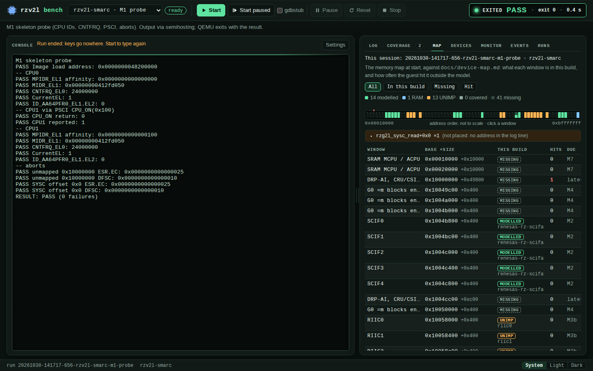
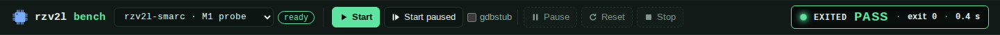
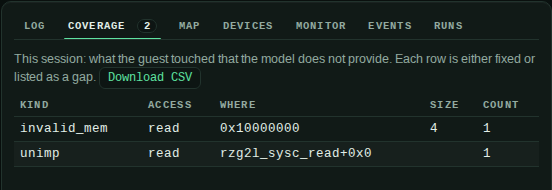
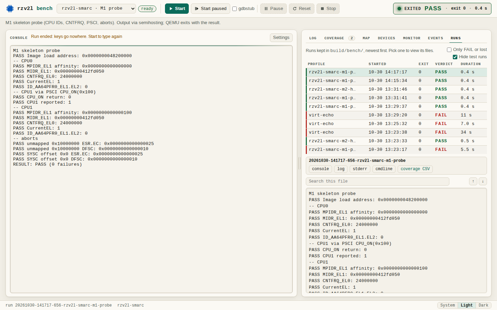

# Using the bench

A guide to the bench screen, with screenshots from a real run: what each part shows, what the buttons do, and what the bench can't see. The reference for profiles, the API and the verdict rules is [`README.md`](README.md).

## What the bench is

The bench is the front panel of **one emulated RZ/V2L board**. Think of sitting at the real EVK: a serial cable on its console, its power and reset buttons, a debugger port. The bench adds views real silicon can't give you: which hardware the software touched that the model doesn't provide yet, and how the board's address space is filled.

It runs **its own QEMU**. When you press Start, the bench launches `qemu-system-aarch64` with a control socket (QMP), a socket for the serial console, and a `-d` debug log. Everything on screen comes from *that* process. A QEMU that you, a test script or an agent start in a terminal is invisible to the bench.

Start it with `uv run bench/server.py` and open `http://127.0.0.1:8090`.

## The screen

What you see, top to bottom:
- **Header:** the logo, the profile picker and its readiness chip, the run buttons, and the readout on the right (LED, state, verdict, exit status, run time).
- **Notes line:** the profile's description; FAIL reasons and the gdb connection line, when they apply.
- **Console** (left): the board's serial port, what `/dev/ttyUSB0` shows on the real EVK.
- **Side panel** (right): the tabs Log, Coverage, Map, Devices, Monitor, Events, Runs.
- **Status bar** (bottom): the run directory, the machine, QEMU's pid while it runs, and the theme switch (System / Light / Dark).

The double bar between the console and the side panel is the **splitter**. Drag it, or focus it and use the arrow keys, to share the width. Double-click it for the default. On narrow screens the two panels stack and the splitter goes away.

## Choosing what to boot: profiles

The dropdown lists **profiles**. Each one is a small TOML file in [`profiles/`](profiles/) that says:
- which QEMU to run;
- which software (the *guest*) to load into the emulated board;
- which console output counts as success.

| Profile | What it runs |
|---|---|
| `rzv2l-smarc · M1 probe` | A small bare-metal test program from milestone M1 (the machine skeleton): CPU IDs, timer frequency, starting the second CPU, faults. Prints `RESULT: PASS`. |
| `rzv2l-smarc · M2 hello` | The M2 test (first character): prints `Hello from RZ/V2L` through the modelled serial port, as the board's firmware does. |
| `virt · bench self-test` | Not the RZ/V2L: stock QEMU `virt`, which the bench uses to test itself. |

As the model grows, profiles are added for real software:
- **G0:** plain upstream Linux to a shell.
- **G1:** Renesas' own boot chain (TF-A, then U-Boot, then Linux).

A new profile is a new TOML file; the screen doesn't change.

The chip next to the dropdown says whether the profile can run:
- **ready:** everything it needs is there.
- **builds on Start:** a prepare step will build the missing files.
- **missing:** no QEMU binary, or files nothing builds.

Hover the chip for the list of files.

## The buttons

| Button | What happens to QEMU |
|---|---|
| **Start** | launches a new QEMU for the profile; the guest runs at once |
| **Start paused** | launches it with the CPUs stopped, so you can look before anything runs; press Resume |
| **gdbstub** (tick before Start) | adds `-gdb` on a free local port and starts paused. The line under the header gives the port and the gdb command, with a copy button |
| **Pause / Resume** | QMP `stop` / `cont`: the emulated CPUs freeze or run on; the process stays |
| **Reset** | QMP `system_reset`, like the board's reset button: the guest boots again in the same process. Markers seen before the reset no longer count |
| **Stop** | QMP `quit`: QEMU shuts down cleanly. If it doesn't answer in 3 s, or hasn't exited 5 s later, the bench kills that process (by its PID only) |

A run you end with Stop counts as **FAIL** when the profile expects QEMU to exit by itself. `quit` also exits with status 0, and would otherwise fake a pass.

## The readout (top right)

The readout is the one status line of the session:
- **LED:** dim = no session · blue = starting · green, pulsing = running · amber = paused · grey = ended · green = PASS · red = FAIL.
- **State:** `RUNNING`, `PAUSED`, `EXITED`.
- **Verdict:** PASS or FAIL, in large type, once decided. While it is still open, `markers 1/2` counts the expected console lines seen so far. A FAIL lists what was missing just below the header.
- **Exit status and run time**, once QEMU has ended.

## The console

The console is the emulated board's **serial port**. Click it to type. The line above it says where your keys go right now; for example, while paused they are queued until Resume. Once Linux runs to a shell, the shell you type into runs *inside the emulated board*, as over a serial cable on the real EVK. Colours, line editing and Ctrl+C work as with `tio` or `picocom`.

- **Ctrl+]** leaves the console and moves focus to the side panel's tabs (as in telnet). The console takes every other key, Tab included.
- **Settings** (above the console): show a bare LF as a new line, and what Enter sends (CR, LF or CRLF). This only changes the display and the keys; the transcript and the verdict always keep the guest's own bytes.

## The side panel

| Tab | What it shows | When it helps |
|---|---|---|
| **Log** | QEMU's `-d` debug log for this run (`unimp`, `guest_errors`, `invalid_mem`). The full QEMU command line sits in a collapsed block at the top. Search with Enter / Shift+Enter; matches are highlighted, the text is unchanged | reading what QEMU complained about, in order |
| **Coverage** | the same log, grouped: every access the guest made to hardware the model doesn't provide, one row per place, with a count. Download as CSV | the to-do list: what this guest needs that isn't modelled yet |
| **Map** | the board's address space from `docs/device-map.md`, one row per window (an address range for one hardware block). Each window is *modelled*, *RAM*, *UNIMP* (a placeholder that reads 0 and logs every access), *covered* or *missing*, with the guest's hits outside the model and the milestone that needs it. The strip above the table shows every window as a segment, in address order; click one to find its row | "what does the guest see at this address, and what did it try to use?" |
| **Devices** | QEMU's own tree of the devices it built for this board (`info qtree`), with a filter, a match count, expand/collapse all, and each property as name / value | checking a device's type, address or settings |
| **Monitor** | read-only QEMU inspection commands (`info mtree`, `info qtree`, `info registers`, `info pic`, …). Anything that changes state is refused | a CPU's registers, the live memory tree |
| **Events** | what QEMU reports as it happens: STOP, RESUME, RESET, SHUTDOWN | following what the buttons and the guest did |
| **Runs** | every run kept in `build/bench/`, newest first, with its verdict stripe; pick one to read its console, log, stderr and command line. Filters: hide test runs, only FAIL or lost | comparing with an earlier run; finding failures |

Map and Devices show the **live session** by default. When you pick a run in Runs, they show that run instead, banded **PAST RUN**, until you click "Show the current session".

## A typical session

1. Pick `rzv2l-smarc · M1 probe`, press **Start**. The console prints the probe's checks; the readout turns **PASS**.
2. Open **Coverage**: two rows, both deliberate. The probe reads an unmapped address (`0x10000000`, an `invalid_mem` row) and an unimplemented SYSC offset (`rzg2l_sysc_read+0x0`, an `unimp` row).
3. Open **Map**: the SYSC window shows *modelled*; the window at `0x10000000` shows *missing* with one hit, and the strip marks it with a red tick. SYSC's message carries a function name, not an address, so the Map lists it above the table as "not placed" rather than dropping it.
4. Open **Runs**: the run is listed with its verdict; pick it to read its files again later.

With a Linux profile the same views answer the bring-up question: where did the boot stop, and which hardware did it want that the model lacks?

## What the bench doesn't do (yet)

- It can't see QEMU runs started elsewhere: acceptance scripts, an agent's boot loop, your terminal. Importing those runs, comparing two runs, and attaching to an external QEMU are proposed next steps, not features.
- No register values inside modelled devices: QEMU has no command for them (`info registers` is the CPU only).
- No board display, LEDs or snapshots yet; see the README for what each needs.
- One session at a time, local only (`127.0.0.1`), no login.
