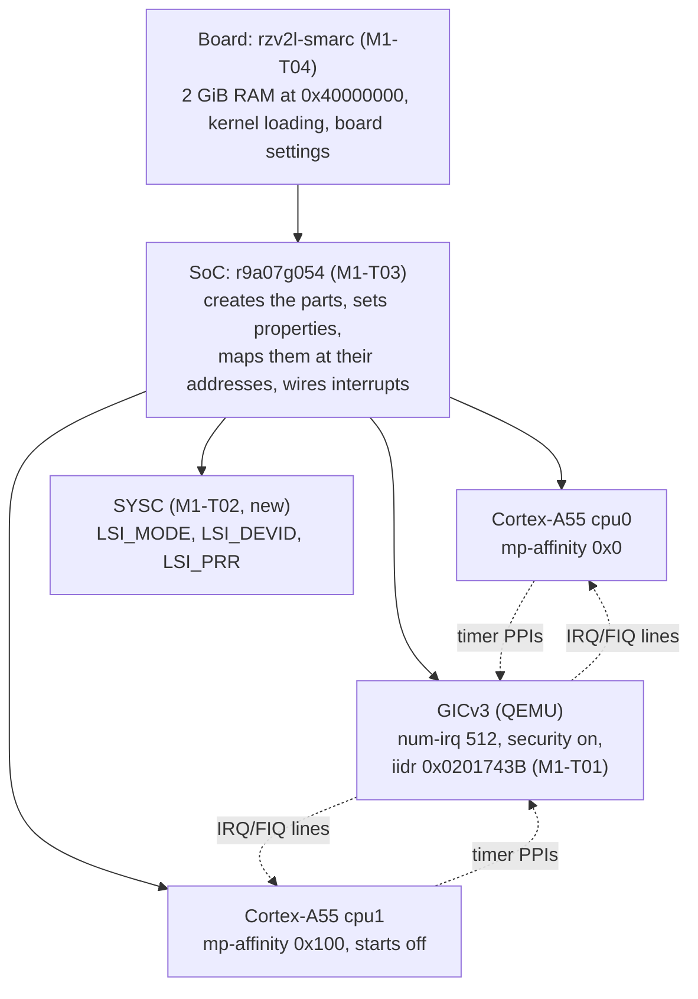
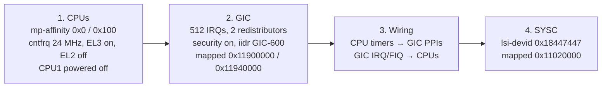

# The M1 machine: a tour

This file shows how the M1 skeleton is put together: the board, the SoC and the devices. It then gives a hands-on tour of `virt` and `rzv2l-smarc` with the monitor. Conventions and reading order: [`README.md`](README.md).

> **Context: milestone M1, the machine skeleton.** `-M rzv2l-smarc` with two Cortex-A55s, the GIC-600, DDR and the SYSC ID registers; nothing prints yet (the console is M2). Goal and exit criterion: [`../spec/project.md` §17](../spec/project.md#17-milestones). The IDs used below are defined in the unit's files: acceptance criteria M1-AC01… in [`../units/M1-machine-skeleton/spec.md`](../units/M1-machine-skeleton/spec.md), the design in [`design.md`](../units/M1-machine-skeleton/design.md), tasks M1-T01–T08 with their mutations in [`tasks.md`](../units/M1-machine-skeleton/tasks.md).

Contents:
1. [Board, SoC, devices: how M1 fits together](#1-board-soc-devices-how-m1-fits-together)
2. [Hands-on recipe](#2-hands-on-recipe)

---

## 1. Board, SoC, devices: how M1 fits together

A QEMU machine is a tree of objects. This section shows the M1 tree, then reads the code of the SoC and of the board.

> "The QOM tree is a composition tree which represents all of the objects that make up a QEMU 'machine'." (`qemu/docs/devel/qom.rst`)



| Task | Layer | What it adds |
|---|---|---|
| T01 | existing device | an `iidr` setting on QEMU's GIC, so the SoC can give it GIC-600's identity |
| T02 | new device | SYSC: the ID and boot-mode registers BL2 and U-Boot read first |
| T03 | SoC | the two CPUs, the GIC and SYSC at their RZ/V2L addresses, interrupt wiring |
| T04 | board | RAM, how a kernel is loaded and entered, the `-M rzv2l-smarc` name |
| T05–T08 | tests and records | a probe program run inside the machine, the acceptance run, DTB checks, traceability |

The tasks go from the bottom up:
1. the parts
2. the chip that holds the parts
3. the board that holds the chip

### 1.1 Reading the SoC: `r9a07g054.c`

The SoC object (`qemu/hw/arm/r9a07g054.c`, M1-T03) has no registers of its own. It does four things with the parts:
- It **creates** them.
- It **configures** them.
- It **places** them at their addresses.
- It **wires** them together.

The template for the SoC is the QEMU i.MX 8M Plus SoC (`qemu/hw/arm/fsl-imx8mp.c`). The line numbers are at fork commit `51378195d3`.

**Two stages, as for all devices ([`qemu-basics.md` §4](qemu-basics.md#4-objects-properties-realize)).**
1. `r9a07g054_init` (`:60`) only creates the children: two `cortex-a55` CPUs, the GIC and the SYSC.
2. `r9a07g054_realize` (`:79`) then sets their properties and switches each child on, in a fixed order:



The CPUs must come first. When the GIC is realized, it reads the `mp-affinity` of each CPU. It copies the value into the redistributor ID register of that CPU, `GICR_TYPER` (`qemu/hw/intc/arm_gicv3_common.c:462-469`). If the SoC set the affinity after the GIC, Linux would see redistributor IDs that do not match the CPUs.

**Interrupts are wires between objects.** QEMU models an interrupt line as a *GPIO*. A GPIO has two ends:
- an output end on the device that raises the interrupt
- an input end on the device that receives it

The SoC connects the ends:

| Call | Connects | Example |
|---|---|---|
| `qdev_connect_gpio_out(cpu, j, gic_in)` | CPU output `j` → a GIC input | CPU0's NS-EL1 physical timer → INTID 30 of CPU0 |
| `qdev_connect_gpio_out_named(cpu, "pmu-interrupt", 0, gic_in)` | a named CPU output → a GIC input | CPU0's PMU → INTID 23 of CPU0 |
| `sysbus_connect_irq(gic, n, cpu_in)` | GIC output `n` → a CPU input | the GIC's "IRQ for CPU1" → CPU1's IRQ pin |

The GIC numbers its inputs in this order (`qemu/hw/intc/arm_gicv3_common.c:321-327`):
1. one input for each shared interrupt (SPI)
2. 32 inputs for each CPU, for the private interrupts of that CPU

```
input index:  0 ............ 479 | 480 ........ 511 | 512 ........ 543
carries:      SPI INTID 32 … 511 | CPU0 INTID 0…31  | CPU1 INTID 0…31
```

Example: the timer of CPU1 at INTID 30 goes to input `480 + 1 × 32 + 30` = 542. The code calculates this as the sum `intidbase + timer_irqs[j]` (`:132`, `:145`).

The outputs of the GIC are in groups by kind (`:155-162`):

| GIC outputs | Kind |
|---|---|
| `0–1` | IRQ for CPU0 and CPU1 |
| `2–3` | FIQ |
| `4–5` | VIRQ |
| `6–7` | VFIQ |

A wrong wire does not stop the build or the start. Nothing finds it until a guest waits for an interrupt that does not come. The timer tick of Linux in M3 is the first real test of this wiring.

**Pass-through properties.** On the EVK, the boot mode and DEBUGEN are pins. The DIP switches and the JTAG header set them. In the model they are SYSC properties. The SoC exports them again under its own name, with `object_property_add_alias` (`:74-76`). The board in M1-T04 forwards them one more time. Thus `-M rzv2l-smarc,boot-mode=3` has the same effect as setting the switches to QSPI before power-on.

**What the SoC does not map, on purpose.** imx8mp fills address ranges that it does not model with *unimplemented device* placeholders. These placeholders read as zero. This SoC maps only SYSC, the GIC and (from the board) RAM. No region owns the other addresses. Thus a guest access to them aborts, and `-d invalid_mem` gives the address ([`qemu-basics.md` §2](qemu-basics.md#2-the-memory-map); `qemu/system/memory.c:1410-1416`, "reason: rejected"). This applies the honest-fault rule to the full address space.

**Build wiring.** `config R9A07G054` in `qemu/hw/arm/Kconfig` selects two options:
- `ARM_GIC`, which adds the GICv3 for TCG
- `RENESAS_RZG2L_SYSC`

This selection is the step that adds the SYSC file to the build. The board (M1-T04) selects `R9A07G054`.

### 1.2 Reading the board: `rzv2l-smarc.c`

The board (`qemu/hw/arm/rzv2l-smarc.c`, M1-T04) is the object that `-M rzv2l-smarc` selects. It holds the parts around the chip on the SMARC module. The line numbers are at fork commit `51378195d3`.

| Piece | Code | Why |
|---|---|---|
| 2 GiB DDR at `0x40000000` | `memory_region_add_subregion(...)` (`:70`); any other `-m` refused (`:50`) | the 2 GB EVK; the Linux memory window below only fits that size |
| SoC | `object_initialize_child(..., TYPE_R9A07G054)`, then realize | the chip from §1.1 |
| Board switches | class properties `boot-mode`, `debugen` (`:115-123`), forwarded to the SoC (`:64-67`), which forwards them to SYSC ([§1.1](#11-reading-the-soc-r9a07g054c)) | `-M rzv2l-smarc,boot-mode=3,debugen=on` = DIP switches on QSPI, JTAG DEBUGEN high |
| Exactly 2 × `cortex-a55` | `mc->min_cpus = max_cpus = 2`, `mc->valid_cpu_types` (`:108-111`) | QEMU's machine core refuses `-smp 1` or `-cpu cortex-a53` with a clear message |
| Direct kernel boot | `arm_boot_info` (`:56-61`), `arm_load_kernel` (`:74`) | below |

**Direct kernel boot.** On the EVK, TF-A and U-Boot run first. They give Linux the memory `0x48000000` + `0x78000000`. The first 128 MiB of DDR hold BL31 and OP-TEE ([`docs/device-map.md`](../device-map.md), DDR row). With `-kernel`, QEMU does the work of that firmware:

```
0x40000000 ┌──────────────────────────────┐
           │ firmware-reserved (empty)    │  BL31, OP-TEE on the EVK; QEMU loads nothing here
0x48000000 ├──────────────────────────────┤  loader_start: QEMU's boot stub, then the Image
           │ Linux memory (/memory node)  │  0x48000000 + 0x78000000, as on the EVK
0xC0000000 └──────────────────────────────┘
```

- `loader_start` = `0x48000000`, `ram_size` = `0x78000000` (`:57-59`). QEMU puts its boot stub and the kernel at this address. It writes the same window into the `/memory` node of the DTB (`qemu/hw/arm/boot.c:571-572`).
- `psci_conduit` = SMC (`:60`). Linux uses `SMC` instructions to start CPU1. The built-in PSCI of QEMU answers them, in place of BL31.
- QEMU enters the kernel at non-secure EL1, as on the EVK. The reason is that the model switches off EL2 in the CPUs ([§1.1](#11-reading-the-soc-r9a07g054c)). The real Cortex-A55 has EL2: this is fidelity gap 14 in [`docs/device-map.md` §4](../device-map.md#4-known-fidelity-gaps-req-guest-004-list-and-model-limits).
- In qtest mode, QEMU loads nothing (`:73`), as in imx8mp. The tests read registers. They do not run a kernel.

**Machine properties are class properties.** `object_class_property_add` declares a property one time, for the machine *type*. The property has a getter and a setter (`:78-96`); for `boot-mode` one visitor function serves as both, because a visitor either reads or writes the value. The setter only stores the value. Later, the `realize` of SYSC checks the value ([`qemu-basics.md` §3.1](qemu-basics.md#31-reading-a-real-device-sysc)). For this reason, the command line accepts `boot-mode=6`. QEMU then refuses it at start-up, with the message from SYSC.

## 2. Hands-on recipe

These commands show the concepts of [`qemu-basics.md`](qemu-basics.md) on a running QEMU. First on `virt`, then on `rzv2l-smarc`.

Build QEMU one time ([`building-and-testing.md` §1](building-and-testing.md#1-first-build)). Then, in `build/qemu`:

```bash
Q="./qemu-system-aarch64 -M virt,gic-version=3 -cpu cortex-a57 -smp 2 -m 1G \
   -S -display none -nodefaults -monitor stdio"

printf 'info mtree -f\nquit\n' | $Q        # memory map (`qemu-basics.md` §2)
printf 'info qtree\nquit\n'    | $Q        # devices and properties (`qemu-basics.md` §4)
printf 'xp /1wx 0x08000008\nquit\n' | $Q   # read GICD_IIDR (`qemu-basics.md` §3)
printf 'xp /1wx 0x08000008\nquit\n' | $Q -global arm-gicv3.iidr=0x0201743b
```

- `-S` keeps the CPUs paused. Only the monitor does work. These commands read, and they change nothing.
- `xp /1wx` means one (`1`) 32-bit word (`w`) in hex (`x`).
- `-global <type>.<property>=<value>` sets a property on all devices of that type.

### 2.1 The same tour on `rzv2l-smarc`

```bash
Q="./qemu-system-aarch64 -M rzv2l-smarc -S -display none -nodefaults -monitor stdio"

printf 'info mtree -f\nquit\n' | $Q          # memory map
printf 'info qom-tree\nquit\n' | $Q          # composition tree
printf 'info qtree\nquit\n'    | $Q          # devices and properties
printf 'xp /3wx 0x11020a00\nquit\n' | ./qemu-system-aarch64 -M rzv2l-smarc,boot-mode=3,debugen=on \
    -S -display none -nodefaults -monitor stdio   # SYSC with the "switches" set
```

The memory map has exactly four windows. All other addresses are holes, and an access to a hole aborts ([`qemu-basics.md` §2](qemu-basics.md#2-the-memory-map)):

```
0000000011020000-000000001102ffff (prio 0, i/o): renesas-rzg2l-sysc
0000000011900000-000000001190ffff (prio 0, i/o): gicv3_dist
0000000011940000-000000001197ffff (prio 0, i/o): gicv3_redist_region[0]
0000000040000000-00000000bfffffff (prio 0, ram): rzv2l-smarc.ram
```

The composition tree is the diagram of §1, as QEMU sees it:

```
/machine (rzv2l-smarc-machine)
  /soc (r9a07g054)
    /cpu0 (cortex-a55-arm-cpu)
    /cpu1 (cortex-a55-arm-cpu)
    /gic (arm-gicv3)
    /sysc (renesas-rzg2l-sysc)
```

`info qtree` shows the properties that the SoC set (part of the output):

```
dev: renesas-rzg2l-sysc, id ""
  boot-mode = 0 (0x0)
  lsi-devid = 407139399 (0x18447447)
  mmio 0000000011020000/0000000000010000
dev: arm-gicv3, id ""
  gpio-in "" 544                 ← 480 SPIs + 2 CPUs × 32 private inputs (§1.1)
  num-irq = 512 (0x200)
  iidr = 33649723 (0x201743b)    ← GIC-600 r1p6 (M1-T01)
  has-security-extensions = true
```

The board switches, from start to end:

```
11020a00: 0x00010203 0x18447447 0x00000000
          └ LSI_MODE  └ DEVID    └ PRR
            bit 16 security, bit 9 DEBUGEN, bits 2:0 = 3 (QSPI)
```

`0x00010203` is the value that the BL2 on the EVK printed most frequently ([`docs/evidence/EVK-2026-10-08-boot-log.md`](../evidence/EVK-2026-10-08-boot-log.md)). It means QSPI boot, with the JTAG DEBUGEN pin high.
