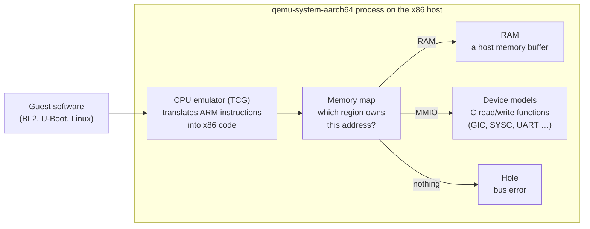
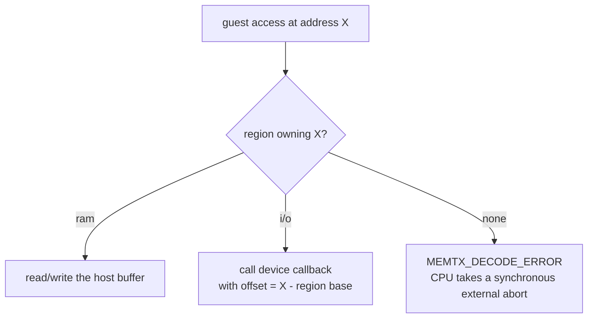
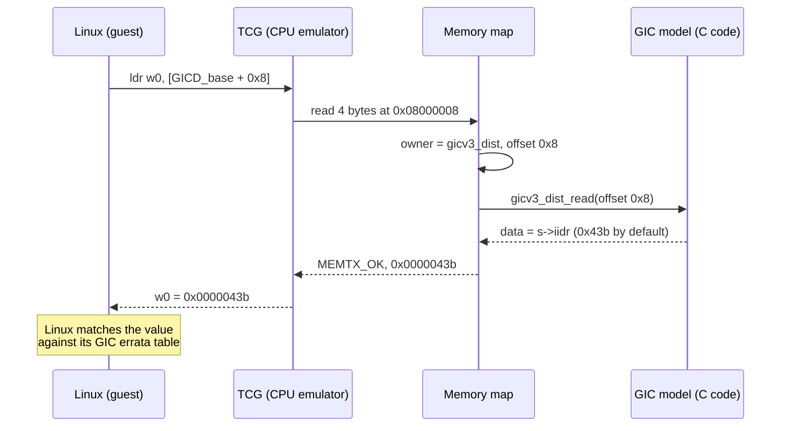
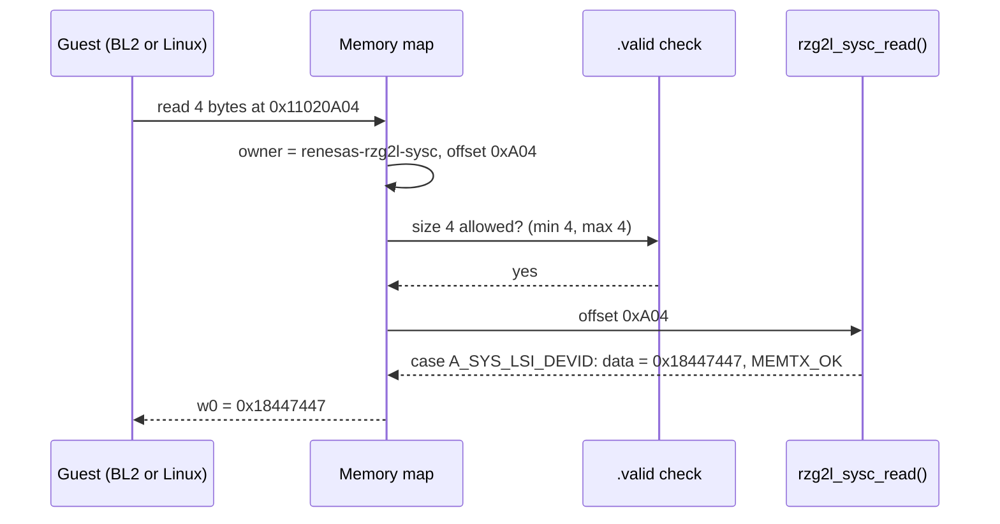
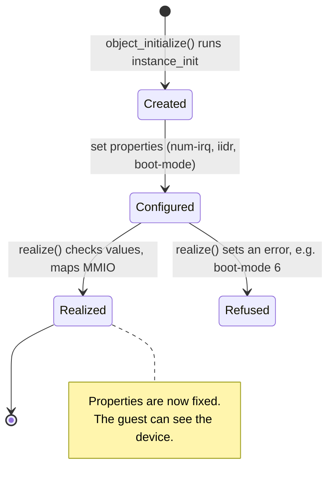
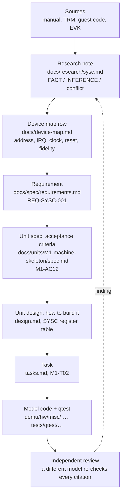

# QEMU basics

This file explains the QEMU concepts that the project uses. The examples come from the ready-made QEMU machine `virt` and from the first RZ/V2L device, SYSC. Conventions and reading order: [`README.md`](README.md).

Contents:
1. [What QEMU is](#1-what-qemu-is)
2. [The memory map](#2-the-memory-map)
3. [A device is a read function and a write function](#3-a-device-is-a-read-function-and-a-write-function)
4. [Objects, properties, realize](#4-objects-properties-realize)
5. [From manual to model: how one register gets in](#5-from-manual-to-model-how-one-register-gets-in)

---

## 1. What QEMU is

`qemu-system-aarch64` is a usual Linux program. Inside this program, three parts work together as a computer:



> "QEMU is a dynamic translator. When it first encounters a piece of code, it converts it to the host instruction set." (`qemu/docs/devel/tcg.rst`)

The guest cannot see that it runs in an emulator, if each address it uses answers as on the real chip. **That is the full job of a machine model.** The model puts the correct part at each address. Each register gives the answer that the hardware manual specifies.

QEMU already has the CPU (Cortex-A55) and many generic devices (the GICv3). This project adds the parts that are specific to the RZ/V2L:
- the SoC layout
- the board
- the Renesas devices, for example SYSC

## 2. The memory map

The memory map tells QEMU which region owns each address. All guest loads and stores go through this map. The QEMU memory API gives these kinds of region:

> "RAM: a RAM region is simply a range of host memory that can be made available to the guest."
>
> "MMIO: a range of guest memory that is implemented by host callbacks; each read or write causes a callback to be called on the host."
>
> "container: a container simply includes other memory regions, each at a different offset."
>
> (`qemu/docs/devel/memory.rst`, "Types of regions")

The monitor command `info mtree -f` shows the flat map that the CPUs see. This output comes from the ready-made machine `virt`. The machine was paused, so no guest code ran:

```
0000000008000000-000000000800ffff (prio 0, i/o): gicv3_dist            ← GIC distributor (MMIO)
00000000080a0000-00000000080dffff (prio 0, i/o): gicv3_redist_region[0] ← GIC redistributors (MMIO)
0000000009000000-0000000009000fff (prio 0, i/o): pl011                 ← UART (MMIO)
0000000040000000-000000007fffffff (prio 0, ram): mach-virt.ram          ← 1 GiB RAM
```

`ram` is usual memory. `i/o` means that the callbacks of a device answer. An address that is not in the list is a **hole**.



A hole is an address that no region owns. The model must not hide a hole (AGENTS.md rule 6, "never silently wrong"). This is how QEMU handles an access to a hole:
1. QEMU puts the region `io_mem_unassigned` behind each hole (`qemu/system/physmem.c:3004`).
2. The `accepts` callback of this region refuses all accesses (`qemu/system/memory.c:1355-1365`).
3. The access returns `MEMTX_DECODE_ERROR` (`qemu/system/memory.c:1483-1486`).
4. The Arm CPU changes this result into a synchronous external abort (`qemu/target/arm/tcg/tlb_helper.c:316-354`).

Result: if the guest uses a part that the model does not have, the guest stops at that exact address. If the model returned zeros, the guest would continue with wrong data. The guest would then fail later, in a place that has no relation to the cause.

This table compares the M1 map for RZ/V2L ([`docs/units/M1-machine-skeleton/design.md`](../units/M1-machine-skeleton/design.md)) with the map of `virt`:

| Region | `virt` | `rzv2l-smarc` (M1) |
|---|---|---|
| GIC distributor | `0x08000000` | `0x11900000` |
| GIC redistributors | `0x080A0000` | `0x11940000` (2 × `0x20000`) |
| SYSC | — | `0x11020000` |
| RAM | `0x40000000`, size from `-m` | `0x40000000`, 2 GiB fixed |
| everything else | other `virt` devices | hole (abort) until a later milestone models it |

## 3. A device is a read function and a write function

A device answers the guest through two C functions: one for reads and one for writes. This section shows these functions in the GIC, then in the SYSC model.

The function `memory_region_init_io()` makes a device region. It takes a `MemoryRegionOps` that holds the callbacks (`qemu/docs/devel/memory.rst`). The GIC distributor registers `gicv3_dist_read` (`qemu/hw/intc/arm_gicv3.c:418`). This function calls `gicd_readl()` (`qemu/hw/intc/arm_gicv3_dist.c:373`). For the identification register, the read is one line:

```c
case GICD_IIDR:              /* offset 0x8 */
    *data = gicv3_iidr(s);   /* returns the "iidr" property */
    return true;
```

(`qemu/hw/intc/arm_gicv3_dist.c:443`)

To model a register is to write a `case` of this type. When the guest reads offset X, the `case` returns the value of the real chip. The value comes from the hardware manual.

This is one read, from start to end. Linux reads `GICD_IIDR` when it probes the GIC (`drivers/irqchip/irq-gic-v3.c` in linux v6.12.59):



The monitor command `xp` shows the same values ("Physical memory dump starting at *addr*", `qemu/hmp-commands.hx`):

```
08000008: 0x0000043b    ← GICD_IIDR  (GIC base 0x08000000 + offset 0x8)
080a0004: 0x0000043b    ← GICR_IIDR  (redistributor base 0x080a0000 + offset 0x4)
```

Two more reads show the other kinds of region:

```
40000000: 0xedfe0dd0            ← RAM: the DTB magic d00dfeed, stored big-endian
0c000000: Cannot access memory  ← hole
```

The DTB is at the start of RAM because `virt` puts it there for bare-metal boots (`qemu/docs/system/arm/virt.rst`: "the DTB is at the start of RAM (0x4000_0000)").

Note: the monitor is not a CPU, so at the hole it only reports a failure. A guest CPU that reads there takes the abort from [§2](#2-the-memory-map).

### 3.1 Reading a real device: SYSC

The GIC is a large device. The SYSC model is small: it has approximately 160 lines, written in M1-T02. It shows all the parts of a QEMU device in one file, `qemu/hw/misc/renesas_rzg2l_sysc.c`. The line numbers are at fork commit `0e2a93b8e9`.

**What SYSC models.** SYSC has three read-only registers. BL2, U-Boot and Linux read them to identify the chip and its boot settings (manual §6.3.42–6.3.44 p.207–209):

| Register | Offset | Returns | Comes from |
|---|---|---|---|
| `SYS_LSI_MODE` | `0xA00` | bit 16 = 1 (security available), bit 9 = DEBUGEN pin, bits 2:0 = boot-mode switches | properties `debugen`, `boot-mode` |
| `SYS_LSI_DEVID` | `0xA04` | `0x18447447` on RZ/V2L | property `lsi-devid`, set by the SoC |
| `SYS_LSI_PRR` | `0xA08` | `0x0` | property `lsi-prr` |

**Names for registers: `REG32` and `FIELD`** (`renesas_rzg2l_sysc.c:27-32`). These macros come from `qemu/include/hw/core/registerfields.h`. They give names to offsets and to bit fields:

```c
REG32(SYS_LSI_MODE, 0xa00)                      /* A_SYS_LSI_MODE = 0xa00 (byte offset)       */
    FIELD(SYS_LSI_MODE, STAT_DEBUGEN, 9, 1)     /* bit 9, 1 bit wide                          */
```

- `REG32` defines `A_SYS_LSI_MODE` = `0xa00`. This is the byte offset that the `switch` uses.
- `REG32` also defines `R_SYS_LSI_MODE` = `0x280`. This is the index in 32-bit words, for devices that keep an array of registers.
- `FIELD` defines the shift, the length and the mask of one field.
- `FIELD_DP32(value, REG, FIELD, x)` ("deposit") writes `x` into that field (`renesas_rzg2l_sysc.c:41-44`).

Thus the bit position is in one place only: the `FIELD` line. The value comes directly from the bit table in the manual. The T02 mutation "`debugen` on bit 8" changes only that line.

**One read, from start to end.** The guest executes `ldr w0, [0x11020A04]`:



**Three accesses that fail, and how the guest sees each failure:**

| Access | Who refuses it | Result for the guest | Logged under |
|---|---|---|---|
| 8- or 16-bit read | QEMU's memory core, before our code (`.valid` sizes, `renesas_rzg2l_sysc.c:105-106`; `qemu/system/memory.c:1404`) | synchronous external abort | `-d invalid_mem` |
| any offset other than the three | our `default:` case returns `MEMTX_DECODE_ERROR` (`renesas_rzg2l_sysc.c:69`, `:95`) | synchronous external abort | `-d unimp` |
| write to one of the three | our write callback ignores it, returns `MEMTX_OK` (`renesas_rzg2l_sysc.c:84-90`) | nothing; value unchanged | `-d guest_errors` |

**Why an unknown offset aborts and does not return 0.** The real SYSC has many other registers. Many of them have a reset value that is not zero (manual Table 6.1 p.167-168).
- A model that returns 0 is *silent-wrong*. The guest continues with a wrong value. The guest then fails much later, far from the cause.
- An abort is *honest-fault*. The guest stops at the exact instruction, and `-d unimp` gives the offset.

The model uses `read_with_attrs` / `write_with_attrs`, not the plain `read` / `write`. Only these two functions can return a `MemTxResult` (`renesas_rzg2l_sysc.c:99-107`).

**Properties and realize** (`renesas_rzg2l_sysc.c:109-141`). The macros `DEFINE_PROP_*` declare the four settings. `realize` refuses a setting that the hardware cannot have:
- `boot-mode` 6 or 7: manual Table 4.1 gives these values as reserved. QEMU stops with "boot-mode 6 is reserved (valid: 0-5)".
- `lsi-devid` 0: the ID is different for each SoC, and no default is correct. QEMU stops with "lsi-devid property must be set". It does not show a wrong ID.

**No reset and no migration state** (`renesas_rzg2l_sysc.c:146-150`). The guest cannot change the device: all values come from properties. Thus a reset has nothing to restore, and a snapshot has nothing to save.

**Build wiring.** Three small changes add the file to the QEMU build:

| File | Line added | Meaning |
|---|---|---|
| `qemu/hw/misc/Kconfig` | `config RENESAS_RZG2L_SYSC` | a build switch; the SoC will `select` it (M1-T03) |
| `qemu/hw/misc/meson.build` | `system_ss.add(when: 'CONFIG_RENESAS_RZG2L_SYSC', …)` | compile the file only when the switch is on |
| `qemu/hw/misc/trace-events` | `renesas_rzg2l_sysc_read(…)`, `…_write(…)` | trace points, see [`building-and-testing.md` §5](building-and-testing.md#5-watching-a-device-at-work-trace-points-and-logs) |

## 4. Objects, properties, realize

QEMU builds each device as an object, in two stages. This section shows the two stages and the settings, called properties, that come between them.

Each device is an *object* in the QEMU Object Model (QOM):

> "The QEMU Object Model provides a framework for registering user creatable types and instantiating objects from those types." … "Mapping internal members to publicly exposed properties" (`qemu/docs/devel/qom.rst`)

QEMU builds a device in two stages:

> "Devices are constructed in two stages: 1) object instantiation via object_initialize() and 2) device realization via the #DeviceState.realized property" … "After successful realization, setting static properties will fail." (`qemu/include/hw/core/qdev.h`)



A **property** is a setting. The code that makes the device chooses it. The guest never sees a property. The guest sees only the register values that the property gives.

QEMU's GICv3 is used by many machines. Thus each difference between chips is a property. `info qtree` shows the properties:

```
dev: arm-gicv3
    num-cpu = 2 (0x2)
    num-irq = 288 (0x120)
    revision = 3 (0x3)
    iidr = 1083 (0x43b)          ← added by M1-T01
    has-security-extensions = false
```

This table shows the same property through a register:

| How the GIC is created | `info qtree` | `xp 0x08000008` |
|---|---|---|
| `virt` default | `iidr = 1083 (0x43b)` | `0x0000043b` |
| `-global arm-gicv3.iidr=0x0201743b` | `iidr = 33649723 (0x201743b)` | `0x0201743b` |

`0x0201743B` is the identity of the Arm GIC-600 r1p6 (GIC-600 TRM 100336_0106_00, Tables 4-5 and 4-22):
- ProductID `0x02`
- revision r1, patch p6
- implementer Arm (`0x43B`)

The RZ/V2L SoC sets this value. Thus Linux sees the same GIC as on the EVK.

The switches on the board are also properties. On the EVK, DIP switches set the boot mode, and `SYS_LSI_MODE` latches it. In the model, the boot mode is the SYSC property `boot-mode`. You choose it at start-up, as you set the switches before power-on.

## 5. From manual to model: how one register gets in

A value goes into the model only when a source supports it. A value that only seems correct is not sufficient. Each value must have a source (AGENTS.md rule 1, "evidence before implementation"). We read the sources in a fixed order of authority:

| Source | What it tells us | Example in this repo |
|---|---|---|
| RZ/V2L hardware manual (Rev 1.50) | intended layout, addresses, reset values | §6.3.43 p.208: `SYS_LSI_DEVID` |
| Arm TRMs (Technical Reference Manuals) | Arm IP inside the SoC, where the Renesas manual defers to Arm | GIC-600 r1p6 TRM: the GIC's ID registers |
| Guest code (Linux, TF-A, U-Boot) | which registers software actually touches, and what it requires | Linux `renesas-soc.c` reads `0xA04` and checks the low 28 bits |
| The physical EVK (board) | what the silicon really does | BL2 prints `0x18447447` at every boot |
| QEMU's own docs and code | how to build it: APIs, existing devices | `docs/devel/memory.rst`, `hw/intc/arm_gicv3*.c` |

If two sources do not agree, AGENTS.md "Sources" gives the decision:
- The manual is the authority for the intended layout and the reset values.
- The silicon is the authority for the actual behaviour.
- The guest code is the authority for what is actually necessary.

We write down each conflict. We never choose a source without a record.

Each finding then goes through the project documents in steps. Each step gets a review:



**Example: `SYS_LSI_DEVID`.** This is the ID register of the SoC, in SYSC at `0x11020A04`.

1. **Manual, register description** (§6.3.43 p.208). Bits [27:0] are the device ID `0x844_7447`. Bits [31:28] are the chip revision.
2. **Manual, register table** (Table 6.1, p.168). The table gives the initial value `H'x841_C447`. This is the ID of the RZ/G2L, not of the RZ/V2L. The manual is not consistent ([`docs/research/sysc.md`](../research/sysc.md), conflict 1).
3. **Guest code decides what is necessary.**
   - Linux reads `0xA04` one time at boot. It compares the low 28 bits with `0x8447447`. If the bits are different, Linux prints "SoC mismatch" and registers no SoC device ([`docs/research/sysc.md` §2.1](../research/sysc.md#21-soc-identification-the-only-access)).
   - If the bits are different, TF-A BL2 panics ([`docs/research/boot-chain-firmware.md`](../research/boot-chain-firmware.md)).
   - Thus the software agrees with the register description.
4. **Silicon decides the revision nibble.** The BL2 on the EVK prints `0x18447447`, that is revision 1 ([`docs/evidence/EVK-2026-10-08-boot-log.md`](../evidence/EVK-2026-10-08-boot-log.md)).
5. **Recorded** in the device map ([`docs/device-map.md`](../device-map.md), SYSC row and post-firmware table). Then recorded as REQ-SYSC-001 and M1-AC12: "WHEN `0x11020A04` is read THEN it SHALL return `0x18447447`".
6. **Designed** as a read-only register. Its value is a property that the SoC sets. All other SYSC offsets abort (design.md, SYSC table).
7. **Built and tested** in M1-T02. A qtest asserts `0x18447447`. The mutation "wrong DEVID constant" must make the qtest red.

Each claim gets a label (AGENTS.md rule 2):
- A *documented fact* comes from the manual or a TRM.
- A *code-derived inference* comes from guest code.
- A *hardware observation* comes from the EVK.
- An *assumption* comes from none of these. It keeps this label until a source confirms it.
