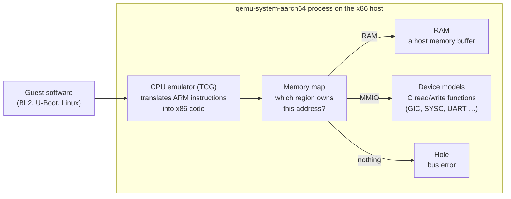
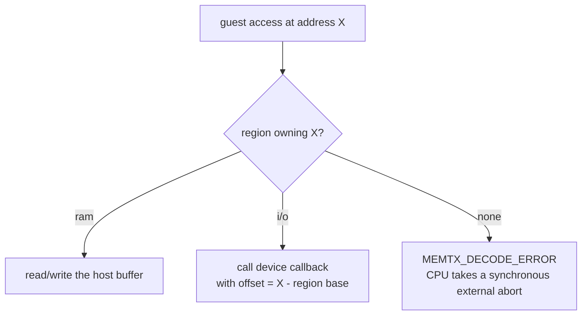
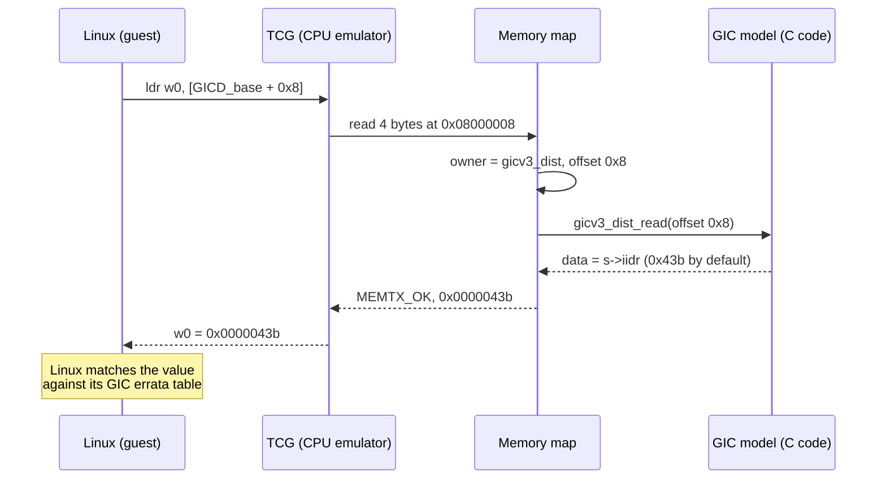
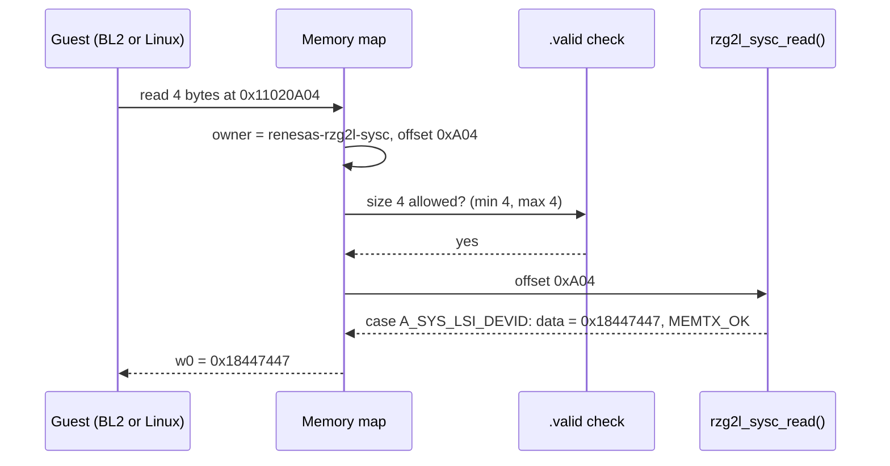
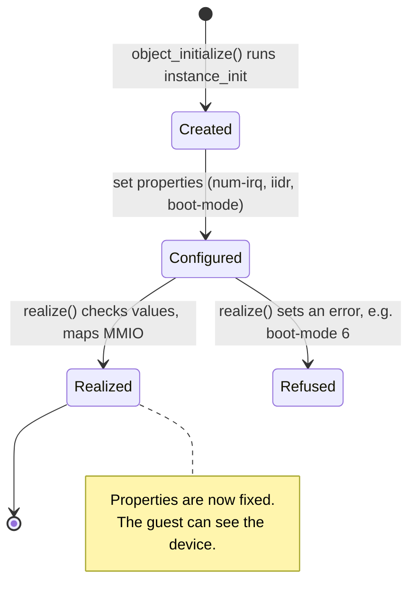
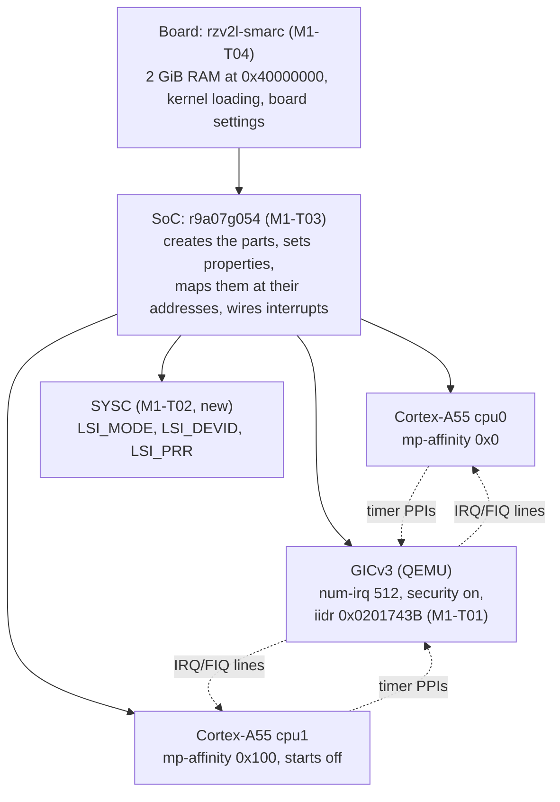
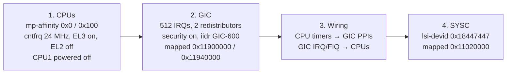
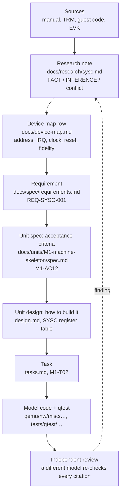
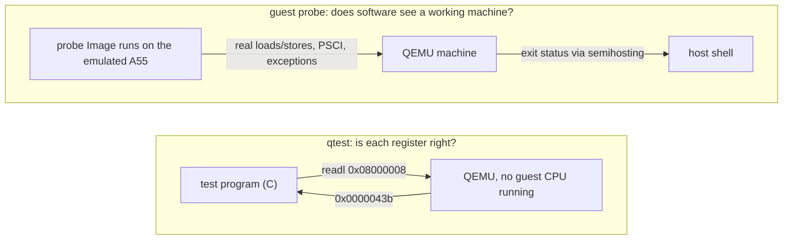

# How QEMU models a machine

A walk-through of the QEMU concepts this project rests on, built from real monitor output. It explains *how* the RZ/V2L model is put together; *what* it must do is set by the spec (`docs/spec/project.md`) and does not change here.

Quotes come from QEMU's own docs in the `qemu/` submodule (v11.1.2) and are cited by path. Code references are `qemu/<file>:<line>` on `unit/M1-machine-skeleton`.

Contents:
1. [What QEMU is](#1-what-qemu-is)
2. [The memory map](#2-the-memory-map)
3. [A device is a read function and a write function](#3-a-device-is-a-read-function-and-a-write-function)
4. [Objects, properties, realize](#4-objects-properties-realize)
5. [Board, SoC, devices: how M1 fits together](#5-board-soc-devices-how-m1-fits-together)
6. [From manual to model: how one register gets in](#6-from-manual-to-model-how-one-register-gets-in)
7. [Testing: qtest and guest probes](#7-testing-qtest-and-guest-probes)
8. [Hands-on recipe](#8-hands-on-recipe)
9. [Glossary](#9-glossary)

---

## 1. What QEMU is

`qemu-system-aarch64` is an ordinary Linux program. Inside it, three things together pretend to be a computer:



> "QEMU is a dynamic translator. When it first encounters a piece of code, it converts it to the host instruction set." (`qemu/docs/devel/tcg.rst`)

The guest cannot tell it is emulated, as long as every address it touches answers the way the real chip would. **That is the whole job of a machine model:** put the right thing at each address, and make each register answer as the hardware manual says.

QEMU already provides the CPU (Cortex-A55) and many generic devices (the GICv3). This project adds what is RZ/V2L-specific: the SoC layout, the board, and Renesas devices such as SYSC.

## 2. The memory map

Every guest load and store goes through one table: which region owns this address. QEMU's memory API describes the kinds of region:

> "RAM: a RAM region is simply a range of host memory that can be made available to the guest."
>
> "MMIO: a range of guest memory that is implemented by host callbacks; each read or write causes a callback to be called on the host."
>
> "container: a container simply includes other memory regions, each at a different offset."
>
> (`qemu/docs/devel/memory.rst`, "Types of regions")

The monitor command `info mtree -f` prints the flattened map that the CPUs see. From QEMU's ready-made `virt` machine (paused, so no guest code ran):

```
0000000008000000-000000000800ffff (prio 0, i/o): gicv3_dist            ← GIC distributor (MMIO)
00000000080a0000-00000000080dffff (prio 0, i/o): gicv3_redist_region[0] ← GIC redistributors (MMIO)
0000000009000000-0000000009000fff (prio 0, i/o): pl011                 ← UART (MMIO)
0000000040000000-000000007fffffff (prio 0, ram): mach-virt.ram          ← 1 GiB RAM
```

`ram` means plain memory, and `i/o` means a device's callbacks. Any address not listed is a **hole**.



Holes are where honesty matters (AGENTS.md rule 6, "never silently wrong"). An unassigned address is backed by QEMU's `io_mem_unassigned` region (`qemu/system/physmem.c:3004`), whose `accepts` callback refuses every access (`qemu/system/memory.c:1355-1365`). The access therefore returns `MEMTX_DECODE_ERROR` (`qemu/system/memory.c:1483-1486`), and the Arm CPU turns that into a synchronous external abort (`qemu/target/arm/tcg/tlb_helper.c:316-354`). A guest that touches something the model lacks therefore fails loudly at the exact address. If the model returned zeros instead, the guest would carry on with wrong data and fail somewhere unrelated.

The M1 map for RZ/V2L (`docs/units/M1-machine-skeleton/design.md`), against `virt`'s:

| Region | `virt` | `rzv2l-smarc` (M1) |
|---|---|---|
| GIC distributor | `0x08000000` | `0x11900000` |
| GIC redistributors | `0x080A0000` | `0x11940000` (2 × `0x20000`) |
| SYSC | — | `0x11020000` |
| RAM | `0x40000000`, size from `-m` | `0x40000000`, 2 GiB fixed |
| everything else | other `virt` devices | hole (abort) until a later milestone models it |

## 3. A device is a read function and a write function

A device region is created with `memory_region_init_io()`, passing a `MemoryRegionOps` with the callbacks (`qemu/docs/devel/memory.rst`). The GIC distributor registers `gicv3_dist_read` (`qemu/hw/intc/arm_gicv3.c:418`), which in turn calls `gicd_readl()` (`qemu/hw/intc/arm_gicv3_dist.c:373`). For the identification register, the read is one line:

```c
case GICD_IIDR:              /* offset 0x8 */
    *data = gicv3_iidr(s);   /* returns the "iidr" property */
    return true;
```

(`qemu/hw/intc/arm_gicv3_dist.c:443`)

"Modelling a register" means writing such a `case`: when the guest reads offset X, return what the real chip returns, with the value taken from the hardware manual.

One read, end to end. Here Linux reads `GICD_IIDR` while probing the GIC (`drivers/irqchip/irq-gic-v3.c` in linux v6.12.59):



Seen live with the monitor's `xp` ("Physical memory dump starting at *addr*", `qemu/hmp-commands.hx`):

```
08000008: 0x0000043b    ← GICD_IIDR  (GIC base 0x08000000 + offset 0x8)
080a0004: 0x0000043b    ← GICR_IIDR  (redistributor base 0x080a0000 + offset 0x4)
```

Two other reads show the remaining region kinds:

```
40000000: 0xedfe0dd0            ← RAM: the DTB magic d00dfeed, stored big-endian
0c000000: Cannot access memory  ← hole
```

The DTB sits at the start of RAM because `virt` places it there for bare-metal boots (`qemu/docs/system/arm/virt.rst`: "the DTB is at the start of RAM (0x4000_0000)"). The monitor is not a CPU, so at the hole it just reports failure; a guest CPU reading there would take the abort from §2.

### 3.1 Reading a real device: SYSC

The GIC is large. The SYSC model written in M1-T02 is about 160 lines and shows every piece of a QEMU device in one file: `qemu/hw/misc/renesas_rzg2l_sysc.c`. (Line numbers are at fork commit `0e2a93b8e9`.)

**What it models.** Three read-only registers BL2, U-Boot and Linux read to identify the chip and its boot setup (manual §6.3.42–6.3.44 p.207–209):

| Register | Offset | Returns | Comes from |
|---|---|---|---|
| `SYS_LSI_MODE` | `0xA00` | bit 16 = 1 (security available), bit 9 = DEBUGEN pin, bits 2:0 = boot-mode switches | properties `debugen`, `boot-mode` |
| `SYS_LSI_DEVID` | `0xA04` | `0x18447447` on RZ/V2L | property `lsi-devid`, set by the SoC |
| `SYS_LSI_PRR` | `0xA08` | `0x0` | property `lsi-prr` |

**Naming registers: `REG32` and `FIELD`** (`renesas_rzg2l_sysc.c:27-32`). Macros from `qemu/include/hw/core/registerfields.h` that give names to offsets and bit fields:

```c
REG32(SYS_LSI_MODE, 0xa00)                      /* A_SYS_LSI_MODE = 0xa00 (byte offset)       */
    FIELD(SYS_LSI_MODE, STAT_DEBUGEN, 9, 1)     /* bit 9, 1 bit wide                          */
```

`REG32` defines `A_SYS_LSI_MODE` = `0xa00`, the byte offset used in the `switch`, and `R_SYS_LSI_MODE` = `0x280`, the index in 32-bit words, for devices that keep a register array. `FIELD` defines the shift, length and mask of one field. `FIELD_DP32(value, REG, FIELD, x)` ("deposit") writes `x` into that field (`renesas_rzg2l_sysc.c:41-44`). The bit position therefore appears once, in the `FIELD` line, and comes straight from the manual's bit table. The T04 mutation "`debugen` on bit 8" changes exactly that line.

**One read, end to end.** A guest `ldr w0, [0x11020A04]`:



**Three ways an access can fail, and why each one fails loudly:**

| Access | Who refuses it | Result for the guest | Logged under |
|---|---|---|---|
| 8- or 16-bit read | QEMU's memory core, before our code (`.valid` sizes, `renesas_rzg2l_sysc.c:105-106`; `qemu/system/memory.c:1404`) | synchronous external abort | `-d invalid_mem` |
| any offset other than the three | our `default:` case returns `MEMTX_DECODE_ERROR` (`renesas_rzg2l_sysc.c:69`, `:95`) | synchronous external abort | `-d unimp` |
| write to one of the three | our write callback ignores it, returns `MEMTX_OK` (`renesas_rzg2l_sysc.c:84-90`) | nothing; value unchanged | `-d guest_errors` |

Why abort instead of returning 0 for unknown offsets: the real SYSC has dozens of other registers, many with non-zero reset values (manual Table 6.1 p.167-168). A model that answered 0 would be *silent-wrong*: the guest would carry on with a wrong value and fail much later, far from the cause. An abort is *honest-fault*: the guest stops at the exact instruction, and `-d unimp` names the offset. `read_with_attrs` / `write_with_attrs` are used instead of plain `read` / `write` because only they can return a `MemTxResult` (`renesas_rzg2l_sysc.c:99-107`).

**Properties and realize** (`renesas_rzg2l_sysc.c:109-141`). The four settings are declared with `DEFINE_PROP_*`. `realize` refuses what the hardware cannot be:
- `boot-mode` 6 or 7: reserved in manual Table 4.1, so QEMU stops with "boot-mode 6 is reserved (valid: 0-5)";
- `lsi-devid` 0: the ID is per SoC and no default is right, so QEMU stops with "lsi-devid property must be set" rather than show a wrong ID.

**No reset, no migration state** (`renesas_rzg2l_sysc.c:146-150`). Nothing the guest does changes the device: every value comes from properties. So there is nothing to restore on reset and nothing to save in a snapshot.

**Build wiring.** Three small edits make QEMU aware of the file:

| File | Line added | Meaning |
|---|---|---|
| `qemu/hw/misc/Kconfig` | `config RENESAS_RZG2L_SYSC` | a build switch; the SoC will `select` it (M1-T03) |
| `qemu/hw/misc/meson.build` | `system_ss.add(when: 'CONFIG_RENESAS_RZG2L_SYSC', …)` | compile the file only when the switch is on |
| `qemu/hw/misc/trace-events` | `renesas_rzg2l_sysc_read(…)`, `…_write(…)` | trace points, see `building-and-testing.md` §5 |

## 4. Objects, properties, realize

Every device is an *object* in the QEMU Object Model (QOM):

> "The QEMU Object Model provides a framework for registering user creatable types and instantiating objects from those types." … "Mapping internal members to publicly exposed properties" (`qemu/docs/devel/qom.rst`)

A device is built in two stages:

> "Devices are constructed in two stages: 1) object instantiation via object_initialize() and 2) device realization via the #DeviceState.realized property" … "After successful realization, setting static properties will fail." (`qemu/include/hw/core/qdev.h`)



A **property** is a setting chosen by whoever creates the device. The guest never sees properties; it sees the register values they produce. QEMU's GICv3 serves many machines, so whatever differs between chips is a property. `info qtree` lists them:

```
dev: arm-gicv3
    num-cpu = 2 (0x2)
    num-irq = 288 (0x120)
    revision = 3 (0x3)
    iidr = 1083 (0x43b)          ← added by M1-T01
    has-security-extensions = false
```

The same property seen through a register:

| How the GIC is created | `info qtree` | `xp 0x08000008` |
|---|---|---|
| `virt` default | `iidr = 1083 (0x43b)` | `0x0000043b` |
| `-global arm-gicv3.iidr=0x0201743b` | `iidr = 33649723 (0x201743b)` | `0x0201743b` |

`0x0201743B` is the Arm GIC-600 r1p6 identity (GIC-600 TRM 100336_0106_00, Tables 4-5 and 4-22): ProductID `0x02`, r1, p6, implementer Arm (`0x43B`). The RZ/V2L SoC sets it, so Linux sees the GIC it would see on the EVK.

Board switches become properties too. On the EVK, the boot mode comes from DIP switches and is latched into `SYS_LSI_MODE`. In the model it is the SYSC `boot-mode` property, chosen at start-up like setting the switches before power-on.

## 5. Board, SoC, devices: how M1 fits together

A machine is a composition tree:

> "The QOM tree is a composition tree which represents all of the objects that make up a QEMU 'machine'." (`qemu/docs/devel/qom.rst`)



| Task | Layer | What it adds |
|---|---|---|
| T01 | existing device | an `iidr` setting on QEMU's GIC, so the SoC can give it GIC-600's identity |
| T02 | new device | SYSC: the ID and boot-mode registers BL2 and U-Boot read first |
| T03 | SoC | the two CPUs, the GIC and SYSC at their RZ/V2L addresses, interrupt wiring |
| T04 | board | RAM, how a kernel is loaded and entered, the `-M rzv2l-smarc` name |
| T05–T08 | tests and records | a probe program run inside the machine, the acceptance run, DTB checks, traceability |

The order is bottom-up: the parts first, then the chip that holds them, then the board that holds the chip.

### 5.1 Reading the SoC: `r9a07g054.c`

The SoC object (`qemu/hw/arm/r9a07g054.c`, M1-T03) adds no register behaviour of its own. It **creates** the parts, **configures** them, **places** them at their addresses and **wires** them together. Its template is QEMU's i.MX 8M Plus SoC (`qemu/hw/arm/fsl-imx8mp.c`). (Line numbers are at fork commit `0e2a93b8e9`.)

**Two stages, as for every device (§4).** `r9a07g054_init` (`:52`) only creates the children: two `cortex-a55` CPUs, the GIC and the SYSC. `r9a07g054_realize` (`:71`) then sets their properties and switches each one on, in a fixed order:



The CPUs must come first: the GIC reads each CPU's `mp-affinity` when it is realized and copies it into that CPU's redistributor ID register, `GICR_TYPER` (`qemu/hw/intc/arm_gicv3_common.c:462-469`). Set the affinity after the GIC and Linux would see redistributors whose IDs don't match the CPUs.

**Interrupts are wires between objects.** QEMU models an interrupt line as a *GPIO*: an output end on the device that raises it, an input end on the device that receives it. The SoC connects the ends:

| Call | Connects | Example |
|---|---|---|
| `qdev_connect_gpio_out(cpu, j, gic_in)` | CPU output `j` → a GIC input | CPU0's NS-EL1 physical timer → INTID 30 of CPU0 |
| `qdev_connect_gpio_out_named(cpu, "pmu-interrupt", 0, gic_in)` | a named CPU output → a GIC input | CPU0's PMU → INTID 23 of CPU0 |
| `sysbus_connect_irq(gic, n, cpu_in)` | GIC output `n` → a CPU input | the GIC's "IRQ for CPU1" → CPU1's IRQ pin |

How the GIC numbers its inputs (`qemu/hw/intc/arm_gicv3_common.c:321-327`): first one input per shared interrupt (SPI), then 32 per CPU for that CPU's private interrupts:

```
input index:  0 ............ 479 | 480 ........ 511 | 512 ........ 543
carries:      SPI INTID 32 … 511 | CPU0 INTID 0…31  | CPU1 INTID 0…31
```

So CPU1's timer at INTID 30 goes to input `480 + 1 × 32 + 30` = 542. That is the `intidbase + timer_irqs[j]` sum in the code (`:124`, `:137`). The other direction is grouped by kind: GIC outputs `0–1` are IRQ for CPU0 and CPU1, `2–3` FIQ, `4–5` VIRQ, `6–7` VFIQ (`:147-154`).

A wrong wire still builds and starts: nothing checks it until a guest waits for an interrupt that never arrives. Linux's timer tick in M3 is the first real test of this wiring.

**Pass-through properties.** On the EVK, the boot mode and DEBUGEN are pins set by DIP switches and the JTAG header. In the model they are SYSC properties, and the SoC re-exports them under its own name with `object_property_add_alias` (`:66-68`). The board in M1-T04 forwards them again, so `-M rzv2l-smarc,boot-mode=3` works like setting the switches to QSPI before power-on.

**What the SoC leaves out on purpose.** imx8mp fills unmodelled address ranges with *unimplemented device* placeholders that read as zero. This SoC maps only SYSC, the GIC and (from the board) RAM; every other address has no owner, so a guest access aborts and `-d invalid_mem` names the address (§2; `qemu/system/memory.c:1410-1416`, "reason: rejected"). That is the honest-fault rule applied to the whole address space.

**Build wiring.** `config R9A07G054` in `qemu/hw/arm/Kconfig` selects `ARM_GIC` (which brings in the GICv3 for TCG) and `RENESAS_RZG2L_SYSC`. Selecting it is what finally pulls the SYSC file into the build; the board (M1-T04) selects `R9A07G054`.


### 5.2 Reading the board: `rzv2l-smarc.c`

The board (`qemu/hw/arm/rzv2l-smarc.c`, M1-T04) is the object `-M rzv2l-smarc` selects. It holds what sits around the chip on the SMARC module. (Line numbers are at fork commit `0e2a93b8e9`.)

| Piece | Code | Why |
|---|---|---|
| 2 GiB DDR at `0x40000000` | `memory_region_add_subregion(...)` (`:70`); any other `-m` refused (`:50`) | the 2 GB EVK; the Linux memory window below only fits that size |
| SoC | `object_initialize_child(..., TYPE_R9A07G054)`, then realize | the chip from §5.1 |
| Board switches | class properties `boot-mode`, `debugen` (`:123-131`), forwarded to the SoC (`:64-67`), which forwards them to SYSC (§5.1) | `-M rzv2l-smarc,boot-mode=3,debugen=on` = DIP switches on QSPI, JTAG DEBUGEN high |
| Exactly 2 × `cortex-a55` | `mc->min_cpus = max_cpus = 2`, `mc->valid_cpu_types` (`:116-119`) | QEMU's machine core refuses `-smp 1` or `-cpu cortex-a53` with a clear message |
| Direct kernel boot | `arm_boot_info` (`:56-61`), `arm_load_kernel` (`:74`) | below |

**Direct kernel boot.** On the EVK, TF-A and U-Boot run first and hand Linux the memory `0x48000000` + `0x78000000`; the first 128 MiB of DDR hold BL31 and OP-TEE (`docs/device-map.md`, DDR row). With `-kernel`, QEMU plays the part of that firmware:

```
0x40000000 ┌──────────────────────────────┐
           │ firmware-reserved (empty)    │  BL31, OP-TEE on the EVK; QEMU loads nothing here
0x48000000 ├──────────────────────────────┤  loader_start: QEMU's boot stub, then the Image
           │ Linux memory (/memory node)  │  0x48000000 + 0x78000000, as on the EVK
0xC0000000 └──────────────────────────────┘
```

- `loader_start` = `0x48000000`, `ram_size` = `0x78000000` (`:57-59`): QEMU places its boot stub and the kernel from there and writes that window into the DTB's `/memory` node (`qemu/hw/arm/boot.c:643-645`).
- `psci_conduit` = SMC (`:60`): QEMU's built-in PSCI answers the `SMC` instructions Linux uses to start CPU1, standing in for BL31.
- The kernel is entered at non-secure EL1, as on the EVK, because the CPUs have no EL2 (§5.1).
- In qtest mode nothing is loaded (`:73`), as in imx8mp: tests read registers, they do not run a kernel.

**Machine properties are class properties.** `object_class_property_add` declares a property once for the machine *type*, with a getter and a setter (`:78-104`). The setter only stores the value; the SYSC's `realize` validates it later (§3.1). That is why `boot-mode=6` gets past the command line and is refused at start-up with the SYSC's message.
## 6. From manual to model: how one register gets in

Nothing goes into the model because it seems plausible. Every value has to be traced to a source (AGENTS.md rule 1, "evidence before implementation"), and the sources are read in a fixed order of authority:

| Source | What it tells us | Example in this repo |
|---|---|---|
| RZ/V2L hardware manual (Rev 1.50) | intended layout, addresses, reset values | §6.3.43 p.208: `SYS_LSI_DEVID` |
| Arm TRMs (Technical Reference Manuals) | Arm IP inside the SoC, where the Renesas manual defers to Arm | GIC-600 r1p6 TRM: the GIC's ID registers |
| Guest code (Linux, TF-A, U-Boot) | which registers software actually touches, and what it requires | Linux `renesas-soc.c` reads `0xA04` and checks the low 28 bits |
| The physical EVK (board) | what the silicon really does | BL2 prints `0x18447447` at every boot |
| QEMU's own docs and code | how to build it: APIs, existing devices | `docs/devel/memory.rst`, `hw/intc/arm_gicv3*.c` |

When sources disagree, AGENTS.md "Sources" decides: the manual is the authority for intended layout and reset values, silicon for actual behaviour, and guest code for what is actually required. The conflict is written down, never silently resolved.

Each finding then moves through the project's documents, one step at a time, each step reviewed:



**Worked example: `SYS_LSI_DEVID`** (the SoC's ID register, in SYSC at `0x11020A04`):

1. **Manual, register description** (§6.3.43 p.208): bits [27:0] are the device ID `0x844_7447`; bits [31:28] are the chip revision.
2. **Manual, register table** (Table 6.1, p.168) gives the initial value `H'x841_C447`. That is the RZ/G2L's ID, not the RZ/V2L's: the manual contradicts itself (`docs/research/sysc.md`, conflict 1).
3. **Guest code decides what is required.** Linux reads `0xA04` once at boot and compares the low 28 bits with `0x8447447`; on a mismatch it prints "SoC mismatch" and registers no SoC device (`docs/research/sysc.md` §2.1). TF-A BL2 panics on a mismatch (`docs/research/boot-chain-firmware.md`). So the register description is the one the software agrees with.
4. **Silicon decides the revision nibble.** The EVK's BL2 prints `0x18447447`, i.e. revision 1 (`docs/evidence/EVK-2026-10-08-boot-log.md`).
5. **Recorded** in the device map (`docs/device-map.md`, SYSC row and post-firmware table), then as REQ-SYSC-001 and M1-AC12: "WHEN `0x11020A04` is read THEN it SHALL return `0x18447447`".
6. **Designed** as a read-only register whose value is a property set by the SoC, with every other SYSC offset aborting (design.md, SYSC table).
7. **Built and tested** in M1-T02: a qtest asserts `0x18447447`, and the mutation "wrong DEVID constant" must turn it red.

Labels matter along the way (AGENTS.md rule 2). A *documented fact* comes from the manual or a TRM, a *code-derived inference* from guest code, a *hardware observation* from the EVK, and an *assumption* is none of these and is marked as such until something confirms it.

## 7. Testing: qtest and guest probes

There are two ways to check a model. They answer different questions.

> "QTest is a device emulation testing framework. It can be very useful to test device models" (`qemu/docs/devel/testing/qtest.rst`)



- **qtest** (M1-T01 to T04) reads registers directly, with no guest code. It is exact and fast, but blind to bus errors (below), and asserts the values from the **hardware manual**, not values copied from the model's own output (AGENTS.md rule 7).
- **The guest probe** (M1-T05, §7.1) is a small program that runs *on* the emulated CPU. It checks what qtest cannot: CPU IDs, the timer frequency, the exception level, PSCI `CPU_ON`, and that unmapped addresses really abort.

**Mutation check.** A test only counts once it has been seen to fail. The model is broken on purpose and the test must turn red:

| Mutation (M1-T01) | Test result |
|---|---|
| none | `ok /arm-gicv3/iidr/default`, `ok /arm-gicv3/iidr/property` |
| default changed `0x43b` → `0x43c` | `not ok …/default`: `(0x0000043c == 0x0000043b)` |
| GICR ignores the property | `not ok …/property`: `(0x0000043b == 0x0201743b)` |

The machine's own qtest (`qemu/tests/qtest/rzv2l-smarc-test.c`, M1-T04) checks T02–T04 together, against manual and TRM values:

| Test | Checks |
|---|---|
| `/rzv2l-smarc/sysc/id` | `DEVID` `0x18447447`, `PRR` `0`, `LSI_MODE` `0x10000`; a write to `DEVID` changes nothing |
| `/rzv2l-smarc/sysc/boot-pins` | `boot-mode=3` → `0x10003`; `debugen=on` → `0x10200` |
| `/rzv2l-smarc/sysc/boot-mode-reserved` | `boot-mode=6`: QEMU refuses to start, with "boot-mode 6 is reserved" (run in a child process, GLib `g_test_trap_subprocess`) |
| `/rzv2l-smarc/gic/layout` | `ITLinesNumber` 15, `LPIS` 0; `GICR_TYPER` affinity `0x0`/`0x100`, `Last` only on the second |
| `/rzv2l-smarc/gic/identity` | `GICD_IIDR`, both `GICR_IIDR` = `0x0201743B`; the 12 PIDR/CIDR bytes of GICD and both GICRs |

| Mutation (M1-T02 to T04) | Test result |
|---|---|
| `DEVID` `0x18447447` → `0x18447448` | `not ok …/sysc/id`: `(0x18447448 == 0x18447447)` |
| `STAT_DEBUGEN` on bit 8 | `not ok …/sysc/boot-pins`: `(0x00010100 == 0x00010200)` |
| CPU1 `mp-affinity` `0x100` → `0x1` | `not ok …/gic/layout`: `(0x00000001 == 0x00000100)` |
| `num-irq` 256, wiring unchanged | red, but QEMU aborts at start-up: the SoC wires a timer to GIC input 510, which no longer exists (`qemu/hw/core/gpio.c:108`). The assertion never ran. |
| 224 SPIs (`num-irq` 256), wiring consistent | `not ok …/gic/layout`: `(7 == 15)` |

The fourth row is a lesson in itself: a red test is not automatically the *right* red. Only the fifth row shows the `ITLinesNumber` assertion doing its job.

**What qtest cannot see: bus errors.** qtest performs reads through QEMU's memory API and discards the transaction result (`qemu/system/qtest.c:555-569`); a failed read simply returns 0. So a qtest cannot tell "bus error" from "reads as zero", and the M1 qtest does not try. Whether an unmodelled SYSC offset or an unmapped address really aborts (AC13, AC14) is checked by the guest probe (M1-T05), where a real CPU must take the exception.

### 7.1 A program inside the machine: the M1 probe

The probe (`tests/probes/m1-skeleton/`, M1-T05) is about 300 lines of C and assembly that run *on* the emulated Cortex-A55s. It checks what qtest cannot see. Run it with `tests/probes/m1-skeleton/run.sh`:

```
M1 skeleton probe
PASS Image load address: 0x0000000048200000
-- CPU0
PASS MPIDR_EL1 affinity: 0x0000000000000000
PASS MIDR_EL1: 0x00000000412fd050
PASS CNTFRQ_EL0: 24000000
PASS CurrentEL: 1
-- CPU1 via PSCI CPU_ON(0x100)
PASS CPU_ON return: 0
PASS CPU1 reported: 1
-- CPU1
PASS MPIDR_EL1 affinity: 0x0000000000000100
...
-- aborts
PASS unmapped 0x10000000 ESR.EC: 0x0000000000000025
PASS unmapped 0x10000000 DFSC: 0x0000000000000010
PASS SYSC offset 0x0 ESR.EC: 0x0000000000000025
PASS SYSC offset 0x0 DFSC: 0x0000000000000010
RESULT: PASS (0 failures)
```

**Pretending to be Linux.** The probe starts with the 64-byte arm64 Image header (`start.S:9-18`). QEMU sees it and takes the same path it takes for a kernel: it loads the image at `loader_start` + 2 MiB = `0x48200000` (header `text_offset` 0, `qemu/hw/arm/boot.c:858-870`), enters it at EL1 and answers PSCI over SMC (§5.2). The probe is linked at that address and checks that it really landed there.

**Talking to the host: semihosting.** The machine has no UART yet, so the probe reports through *semihosting*: the instruction `HLT #0xF000` (`start.S:60`) asks QEMU to do something on the guest's behalf, with an operation number in `x0` and a parameter in `x1`. The probe uses two operations:

| Operation | Number | What QEMU does |
|---|---|---|
| `SYS_WRITE0` | `0x04` | prints a NUL-terminated string, to QEMU's **stderr** |
| `SYS_EXIT` | `0x18` | with the A64 parameter block {`0x20026` = application exit, status}, QEMU itself exits with that status (`qemu/semihosting/arm-compat-semi.c:751-772`) |

So `qemu-system-aarch64`'s own exit status is the probe's verdict, and a shell script can check `$?`. Semihosting is off unless `-semihosting-config enable=on` is given: it is a property of the test run, not of the board. Without it `HLT` is an undefined instruction.

**Starting the second CPU.** CPU1 is powered off at start (§5.1). The probe calls PSCI `CPU_ON` the way Linux does: `SMC #0` with `x0` = `0xC4000003` (CPU_ON, 64-bit), `x1` = target affinity `0x100`, `x2` = entry address (`probe.c:239`). QEMU's built-in PSCI powers CPU1 on at `secondary_entry` (`start.S:41`), which reads its own four values into a mailbox in RAM; CPU0 waits for the mailbox with a timeout.

**Catching an abort.** To prove a read aborts, the probe installs its own exception vector table (`start.S:81`), a 2 KiB block of 16 entries the CPU jumps to on an exception. The handler (`probe.c:123`) reads `ESR_EL1`, the *Exception Syndrome Register*, which says what happened:

```
ESR_EL1 = 0x96000010
          ││     └┴─ DFSC [5:0] = 0x10: synchronous external abort (the bus said no)
          └┴──────── EC [31:26] = 0x25: data abort taken without changing EL
```

(The remaining set bit, 25, is IL: the faulting instruction was 32 bits. QEMU's `-d int` log shows the same value: `Taking exception 4 [Data Abort] … with ESR 0x25/0x96000010`.)

It then adds 4 to `ELR_EL1` (the return address) so `eret` resumes *after* the faulting load (`probe.c:150`), and the probe carries on. If the load completes instead, nothing was caught and the check fails: that is exactly what a zero-reading placeholder would cause.

The same reads appear in QEMU's log with `-d unimp,guest_errors,invalid_mem` (`run.sh` keeps it in `out/qemu.log`):

```
Invalid read at addr 0x10000000, size 4, region '(null)', reason: rejected   ← invalid_mem: hole
rzg2l_sysc_read: unimplemented read at offset 0x0                            ← unimp: SYSC default case
```

| Mutation (M1-T05) | Probe result |
|---|---|
| none | `RESULT: PASS (0 failures)`, exit 0 |
| SoC `cntfrq` 24 MHz → 62.5 MHz | `FAIL CNTFRQ_EL0: 62500000 (expected 24000000)` on both CPUs, exit 1 |
| zero-reading window at `0x10000000` (`create_unimplemented_device`, as imx8mp does for its holes) | `FAIL unmapped 0x10000000: read completed without an abort`, exit 1 |
| semihosting off | no output; `run.sh`: "no RESULT line … probe did not finish", exit 2 after its 20 s timeout |

**A lesson from the last row.** The first version of the handler tried to *print* the unexpected exception, which executes `HLT` again, which is undefined again: the exceptions nested until the stack ran down through memory into the GIC's registers, and `-d guest_errors` filled with stray GIC writes. The handler now parks the CPU if it is entered while already handling an exception (`probe.c:128`). A test harness has to fail cleanly too.

### 7.2 The acceptance run: is M1 done?

`tests/acceptance/m1/run.sh` (M1-T06) answers that with one exit code. It combines the probe (§7.1) with what only the whole running machine shows:

```
== -M help
PASS -M help lists rzv2l-smarc
== info mtree -f
PASS mtree: 4 windows, nothing else
== info qtree
PASS qtree: 3 devices, 14 properties
== info roms
PASS roms: 2 blobs, none in 0x40000000-0x47ffffff
== guest probe
RESULT: PASS (0 failures)
PASS probe exited 0
== log gate
PASS log: only the 2 allowed line(s)

M1 ACCEPTANCE: PASS
```

**Expected values come from the documents, not from QEMU.** The files in `tests/acceptance/m1/expected/` are written from `docs/device-map.md`, and each one says which rows it comes from. Copying QEMU's output into them would only prove that the model has not changed since, not that it is right (AGENTS.md rule 7). So the checks are shaped by what the documents actually state:

| Check | Match | Why that shape |
|---|---|---|
| `info mtree -f`, the flat view of the "memory" address space | **exact**: these 4 lines, nothing else | the device map gives every window's base and size; an extra window is a failure |
| `info qtree` | **exact device set**; per device, only the listed lines (base, size, `lsi-devid`, `num-irq`, `iidr` …) | QEMU prints internal properties (`force-8-bit-prio`, `first-cpu-index`) that no project document defines |
| `info roms` | a **rule**: every blob inside the Linux window `0x48000000`–`0xBFFFFFFF`, none in the firmware-reserved `0x40000000`–`0x47FFFFFF` | AC07; the exact blob list depends on the payload |
| the probe | exit status 0 | §7.1 |
| `-d unimp,guest_errors,invalid_mem` log of the probe run | an **allow-list** of exactly the probe's two deliberate abort reads | anything else the guest touches is either modelled or listed (REQ-TEST-003) |

`info roms` lists what QEMU will copy into guest memory at reset. With `-kernel`, those are its 40-byte boot stub at `0x48000000` and the image at `0x48200000`.

| Mutation (M1-T06) | What fails |
|---|---|
| SYSC moved to `0x11030000` | mtree (diff printed), qtree (`missing 'mmio 0000000011020000/…'`), log (`Invalid read at addr 0x11020000`) |
| board `loader_start` → `0x40000000` | roms (boot stub and image overlap reserved DDR), probe (`Image load address: 0x40200000`) |
| SYSC logs one extra guest-error line | log gate only: `rzg2l_sysc_read: extra` |

**Why the checks belong together.** With SYSC moved, the *probe still passes*: its read of `0x11020000` aborts either way, because the address has become a hole. Only the memory map, the device list and the log gate notice that the abort now comes from the wrong place. Each check is blind somewhere; together they cover each other.

## 8. Hands-on recipe

Build once (`building-and-testing.md` §1), then from `build/qemu`:

```bash
Q="./qemu-system-aarch64 -M virt,gic-version=3 -cpu cortex-a57 -smp 2 -m 1G \
   -S -display none -nodefaults -monitor stdio"

printf 'info mtree -f\nquit\n' | $Q        # memory map (§2)
printf 'info qtree\nquit\n'    | $Q        # devices and properties (§4)
printf 'xp /1wx 0x08000008\nquit\n' | $Q   # read GICD_IIDR (§3)
printf 'xp /1wx 0x08000008\nquit\n' | $Q -global arm-gicv3.iidr=0x0201743b
```

- `-S` keeps the CPUs paused, so only the monitor acts: these commands read and change nothing.
- `xp /1wx` means one (`1`) 32-bit word (`w`) in hex (`x`).
- `-global <type>.<property>=<value>` sets a property on every device of that type.

### 8.1 The same tour on `rzv2l-smarc`

```bash
Q="./qemu-system-aarch64 -M rzv2l-smarc -S -display none -nodefaults -monitor stdio"

printf 'info mtree -f\nquit\n' | $Q          # memory map
printf 'info qom-tree\nquit\n' | $Q          # composition tree
printf 'info qtree\nquit\n'    | $Q          # devices and properties
printf 'xp /3wx 0x11020a00\nquit\n' | ./qemu-system-aarch64 -M rzv2l-smarc,boot-mode=3,debugen=on \
    -S -display none -nodefaults -monitor stdio   # SYSC with the "switches" set
```

The memory map holds exactly four windows; everything else is a hole that aborts (§2):

```
0000000011020000-000000001102ffff (prio 0, i/o): renesas-rzg2l-sysc
0000000011900000-000000001190ffff (prio 0, i/o): gicv3_dist
0000000011940000-000000001197ffff (prio 0, i/o): gicv3_redist_region[0]
0000000040000000-00000000bfffffff (prio 0, ram): rzv2l-smarc.ram
```

The composition tree is the diagram of §5, as QEMU sees it:

```
/machine (rzv2l-smarc-machine)
  /soc (r9a07g054)
    /cpu0 (cortex-a55-arm-cpu)
    /cpu1 (cortex-a55-arm-cpu)
    /gic (arm-gicv3)
    /sysc (renesas-rzg2l-sysc)
```

`info qtree` shows the properties the SoC set (excerpt):

```
dev: renesas-rzg2l-sysc, id ""
  boot-mode = 0 (0x0)
  lsi-devid = 407139399 (0x18447447)
  mmio 0000000011020000/0000000000010000
dev: arm-gicv3, id ""
  gpio-in "" 544                 ← 480 SPIs + 2 CPUs × 32 private inputs (§5.1)
  num-irq = 512 (0x200)
  iidr = 33649723 (0x201743b)    ← GIC-600 r1p6 (M1-T01)
  has-security-extensions = true
```

And the board switches, end to end:

```
11020a00: 0x00010203 0x18447447 0x00000000
          └ LSI_MODE  └ DEVID    └ PRR
            bit 16 security, bit 9 DEBUGEN, bits 2:0 = 3 (QSPI)
```

`0x00010203` is the value the EVK's BL2 printed most often (`docs/evidence/EVK-2026-10-08-boot-log.md`): QSPI boot with the JTAG DEBUGEN pin high.

## 9. Glossary

**Hardware: the chip and board**

| Term | Meaning |
|---|---|
| SoC | System on Chip: CPUs, interrupt controller, memory controller and peripherals on one die. Here the Renesas RZ/V2L, part number R9A07G054. |
| EVK | Evaluation Kit: the RZ/V2L SMARC board this project models; also the physical reference ("oracle") for measurements. |
| SYSC | System Controller, a Renesas block at `0x11020000`: product ID, captured boot pins, bus security and low-power control (manual §6.1.1). M1 models only its three ID/mode registers. |
| Register | A fixed-width value at an address inside a device; software reads or writes it to query or control the hardware. |
| Reset value | What a register holds right after power-on or reset, before software writes it. |
| MMIO | Memory-mapped I/O: device registers reached with ordinary loads and stores at fixed addresses. |
| GIC | Generic Interrupt Controller (Arm). Collects interrupts from devices and delivers them to CPUs. The RZ/V2L has a GIC-600, which implements the GICv3 architecture. |
| GICD / distributor | The GIC part shared by all CPUs: enables, prioritises and routes shared interrupts. |
| GICR / redistributor | The per-CPU GIC part: that CPU's private interrupts and its connection to the distributor. |
| ITS | Interrupt Translation Service: GIC block for message-signalled interrupts (PCIe). The RZ/V2L has none. |
| SGI / PPI / SPI | Interrupt kinds by ID (INTID): software-generated (0-15), private per-CPU (16-31, e.g. the timers), shared peripheral (32 and up, e.g. a UART). |
| IIDR | Implementer Identification Register: the GIC's "nameplate" (implementer, product, revision). |
| TRM | Technical Reference Manual: Arm's document for one IP block, e.g. the GIC-600 TRM. |
| Cortex-A55 | The Arm CPU core in the RZ/V2L (two of them). |
| MPIDR / affinity | The CPU's own ID register; its affinity fields name the CPU (`0x0` and `0x100` here) and must match the DT `cpu@0`, `cpu@100`. |
| EL0-EL3 | Arm exception levels: EL0 applications, EL1 kernel, EL2 hypervisor, EL3 secure monitor (TF-A). |
| CNTFRQ | The generic timer's frequency register; 24 MHz on this board. |
| DIP switch / boot mode | Physical switches on the board that select the boot source; latched into `SYS_LSI_MODE` at power-on. |

**Software: firmware and guests**

| Term | Meaning |
|---|---|
| Guest | Software running inside the emulated machine (as opposed to the host, the PC running QEMU). |
| TF-A, BL2, BL31 | Trusted Firmware-A, the first firmware after the boot ROM. BL2 loads the next stages; BL31 stays resident at EL3 and serves PSCI. |
| U-Boot | The bootloader that loads Linux. |
| OP-TEE | The secure-world OS running beside Linux. |
| PSCI | Power State Coordination Interface: the firmware call Linux uses to power CPUs on and off (here via the `SMC` instruction). |
| DT / DTB | Device tree / device tree blob: the hardware description the kernel reads at boot. |
| G0 / G1 / G2 | This project's guest tiers: mainline Linux (G0), the Renesas BSP (G1), downstream products (G2, integration only). |

**QEMU**

| Term | Meaning |
|---|---|
| TCG | Tiny Code Generator: QEMU's CPU emulator, which translates guest ARM instructions into host x86 code (§1). |
| KVM | Running the guest directly on the host CPU via the Linux kernel; needs a host of the same architecture, so not used here. |
| Memory region | QEMU's unit of the memory map: RAM, MMIO (callbacks) or a container (§2). |
| Memory map / `info mtree` | Which region owns which address; the monitor command prints it. |
| QOM | QEMU Object Model: types, objects and the composition tree a machine is built from (§4). |
| Property | A setting on a device, chosen by its creator before realize; the guest sees only its effect on registers (§4). |
| Realize | The step that switches a configured device on; it can refuse bad settings (§4). |
| Machine / board | The top-level QEMU object, selected with `-M` (here `rzv2l-smarc`). |
| Monitor | QEMU's command console (`info mtree`, `info qtree`, `xp`). |
| qtest | Test mode where a test program reads and writes addresses directly, with no guest CPU (§7). |
| Semihosting | A channel letting a guest program talk to QEMU, e.g. to report an exit status; used by the M1 probe. |

**This project's process**

| Term | Meaning |
|---|---|
| Milestone (M0, M1 …) | A stage of the project with exit criteria; M1 is the machine skeleton. |
| Unit | One reviewed piece of work in a milestone, with its own spec, design and tasks (`docs/units/`). |
| REQ-… | A project requirement (`docs/spec/requirements.md`). |
| AC | Acceptance criterion: a testable statement in a unit spec, e.g. M1-AC12. |
| Task (T01 …) | One implementation step of a unit, usually one commit (`tasks.md`). |
| DR | Decision record (`docs/decisions/`), e.g. DR-0003 on the GIC identity. |
| Fidelity class | How much of a device is modelled (FULL / FUNCTIONAL / STUB / UNSUPPORTED), and whether it fails honestly (honest-fault) or lies (silent-wrong, never allowed). |
| Mutation check | Breaking the model on purpose to prove a test can fail (§7). |
| Direct-kernel / firmware mode | Two start states: QEMU boots Linux directly (devices start as firmware would leave them) or runs the real firmware (devices start at reset values). |
