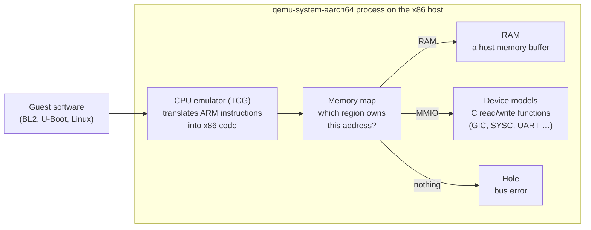
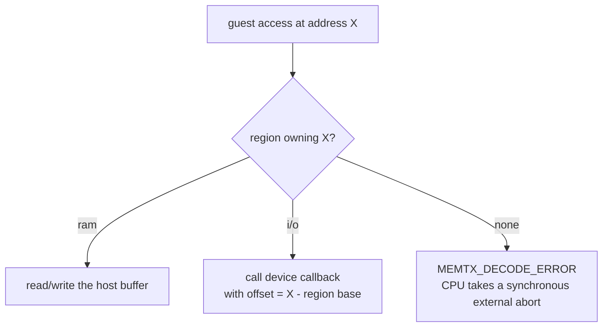
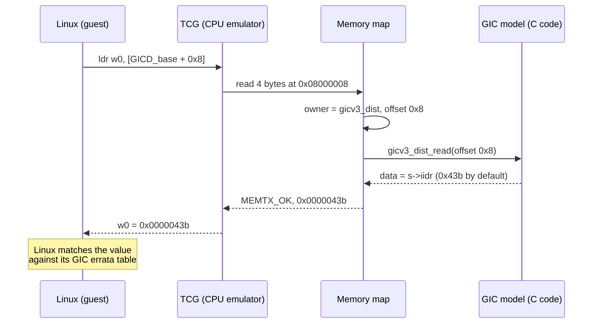
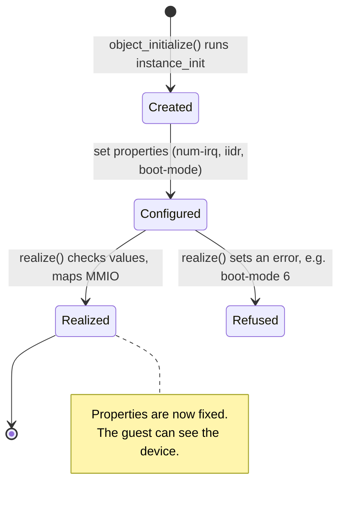
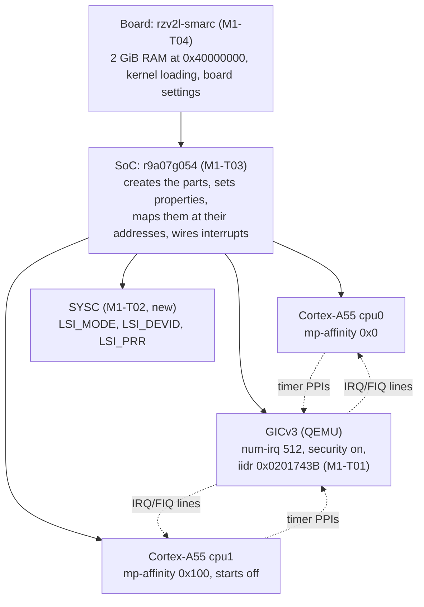
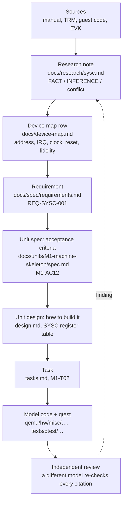
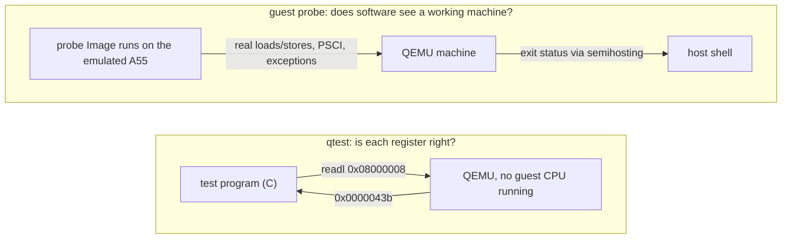

# How QEMU models a machine

A walk-through of the QEMU concepts this project rests on, built from real monitor output. It explains *how* the RZ/V2L model is put together; *what* it must do is set by the spec (`docs/spec/project.md`) and does not change here.

Quotes come from QEMU's own docs in the `qemu/` submodule (v11.1.2) and are cited by path. Code references are `qemu/<file>:<line>` on `unit/M1-machine-skeleton`.

Contents:
1. [What QEMU is](#1-what-qemu-is)
2. [The memory map](#2-the-memory-map)
3. [A device is a read function and a write function](#3-a-device-is-a-read-function-and-a-write-function)
4. [Objects, properties, realize](#4-objects-properties-realize)
5. [Board, SoC, devices: how M1 fits together](#5-board-soc-devices-how-m1-fits-together)
6. [From manual to model: how one register gets in](#6-from-manual-to-model-how-one-register-gets-in)
7. [Testing: qtest and guest probes](#7-testing-qtest-and-guest-probes)
8. [Hands-on recipe](#8-hands-on-recipe)
9. [Glossary](#9-glossary)

---

## 1. What QEMU is

`qemu-system-aarch64` is an ordinary Linux program. Inside it, three things together pretend to be a computer:



> "QEMU is a dynamic translator. When it first encounters a piece of code, it converts it to the host instruction set." (`qemu/docs/devel/tcg.rst`)

The guest cannot tell it is emulated, as long as every address it touches answers the way the real chip would. **That is the whole job of a machine model:** put the right thing at each address, and make each register answer as the hardware manual says.

QEMU already provides the CPU (Cortex-A55) and many generic devices (the GICv3). This project adds what is RZ/V2L-specific: the SoC layout, the board, and Renesas devices such as SYSC.

## 2. The memory map

Every guest load and store goes through one table: which region owns this address. QEMU's memory API describes the kinds of region:

> "RAM: a RAM region is simply a range of host memory that can be made available to the guest."
>
> "MMIO: a range of guest memory that is implemented by host callbacks; each read or write causes a callback to be called on the host."
>
> "container: a container simply includes other memory regions, each at a different offset."
>
> (`qemu/docs/devel/memory.rst`, "Types of regions")

The monitor command `info mtree -f` prints the flattened map that the CPUs see. From QEMU's ready-made `virt` machine (paused, so no guest code ran):

```
0000000008000000-000000000800ffff (prio 0, i/o): gicv3_dist            ← GIC distributor (MMIO)
00000000080a0000-00000000080dffff (prio 0, i/o): gicv3_redist_region[0] ← GIC redistributors (MMIO)
0000000009000000-0000000009000fff (prio 0, i/o): pl011                 ← UART (MMIO)
0000000040000000-000000007fffffff (prio 0, ram): mach-virt.ram          ← 1 GiB RAM
```

`ram` means plain memory, and `i/o` means a device's callbacks. Any address not listed is a **hole**.



Holes are where honesty matters (AGENTS.md rule 6, "never silently wrong"). An unassigned address is backed by QEMU's `io_mem_unassigned` region (`qemu/system/physmem.c:3004`), whose `accepts` callback refuses every access (`qemu/system/memory.c:1355-1365`). The access therefore returns `MEMTX_DECODE_ERROR` (`qemu/system/memory.c:1483-1486`), and the Arm CPU turns that into a synchronous external abort (`qemu/target/arm/tcg/tlb_helper.c:316-354`). A guest that touches something the model lacks therefore fails loudly at the exact address. If the model returned zeros instead, the guest would carry on with wrong data and fail somewhere unrelated.

The M1 map for RZ/V2L (`docs/units/M1-machine-skeleton/design.md`), against `virt`'s:

| Region | `virt` | `rzv2l-smarc` (M1) |
|---|---|---|
| GIC distributor | `0x08000000` | `0x11900000` |
| GIC redistributors | `0x080A0000` | `0x11940000` (2 × `0x20000`) |
| SYSC | — | `0x11020000` |
| RAM | `0x40000000`, size from `-m` | `0x40000000`, 2 GiB fixed |
| everything else | other `virt` devices | hole (abort) until a later milestone models it |

## 3. A device is a read function and a write function

A device region is created with `memory_region_init_io()`, passing a `MemoryRegionOps` with the callbacks (`qemu/docs/devel/memory.rst`). The GIC distributor registers `gicv3_dist_read` (`qemu/hw/intc/arm_gicv3.c:418`), which in turn calls `gicd_readl()` (`qemu/hw/intc/arm_gicv3_dist.c:373`). For the identification register, the read is one line:

```c
case GICD_IIDR:              /* offset 0x8 */
    *data = gicv3_iidr(s);   /* returns the "iidr" property */
    return true;
```

(`qemu/hw/intc/arm_gicv3_dist.c:443`)

"Modelling a register" means writing such a `case`: when the guest reads offset X, return what the real chip returns, with the value taken from the hardware manual.

One read, end to end. Here Linux reads `GICD_IIDR` while probing the GIC (`drivers/irqchip/irq-gic-v3.c` in linux v6.12.59):



Seen live with the monitor's `xp` ("Physical memory dump starting at *addr*", `qemu/hmp-commands.hx`):

```
08000008: 0x0000043b    ← GICD_IIDR  (GIC base 0x08000000 + offset 0x8)
080a0004: 0x0000043b    ← GICR_IIDR  (redistributor base 0x080a0000 + offset 0x4)
```

Two other reads show the remaining region kinds:

```
40000000: 0xedfe0dd0            ← RAM: the DTB magic d00dfeed, stored big-endian
0c000000: Cannot access memory  ← hole
```

The DTB sits at the start of RAM because `virt` places it there for bare-metal boots (`qemu/docs/system/arm/virt.rst`: "the DTB is at the start of RAM (0x4000_0000)"). The monitor is not a CPU, so at the hole it just reports failure; a guest CPU reading there would take the abort from §2.

## 4. Objects, properties, realize

Every device is an *object* in the QEMU Object Model (QOM):

> "The QEMU Object Model provides a framework for registering user creatable types and instantiating objects from those types." … "Mapping internal members to publicly exposed properties" (`qemu/docs/devel/qom.rst`)

A device is built in two stages:

> "Devices are constructed in two stages: 1) object instantiation via object_initialize() and 2) device realization via the #DeviceState.realized property" … "After successful realization, setting static properties will fail." (`qemu/include/hw/core/qdev.h`)



A **property** is a setting chosen by whoever creates the device. The guest never sees properties; it sees the register values they produce. QEMU's GICv3 serves many machines, so whatever differs between chips is a property. `info qtree` lists them:

```
dev: arm-gicv3
    num-cpu = 2 (0x2)
    num-irq = 288 (0x120)
    revision = 3 (0x3)
    iidr = 1083 (0x43b)          ← added by M1-T01
    has-security-extensions = false
```

The same property seen through a register:

| How the GIC is created | `info qtree` | `xp 0x08000008` |
|---|---|---|
| `virt` default | `iidr = 1083 (0x43b)` | `0x0000043b` |
| `-global arm-gicv3.iidr=0x0201743b` | `iidr = 33649723 (0x201743b)` | `0x0201743b` |

`0x0201743B` is the Arm GIC-600 r1p6 identity (GIC-600 TRM 100336_0106_00, Tables 4-5 and 4-22): ProductID `0x02`, r1, p6, implementer Arm (`0x43B`). The RZ/V2L SoC sets it, so Linux sees the GIC it would see on the EVK.

Board switches become properties too. On the EVK, the boot mode comes from DIP switches and is latched into `SYS_LSI_MODE`. In the model it is the SYSC `boot-mode` property, chosen at start-up like setting the switches before power-on.

## 5. Board, SoC, devices: how M1 fits together

A machine is a composition tree:

> "The QOM tree is a composition tree which represents all of the objects that make up a QEMU 'machine'." (`qemu/docs/devel/qom.rst`)



| Task | Layer | What it adds |
|---|---|---|
| T01 | existing device | an `iidr` setting on QEMU's GIC, so the SoC can give it GIC-600's identity |
| T02 | new device | SYSC: the ID and boot-mode registers BL2 and U-Boot read first |
| T03 | SoC | the two CPUs, the GIC and SYSC at their RZ/V2L addresses, interrupt wiring |
| T04 | board | RAM, how a kernel is loaded and entered, the `-M rzv2l-smarc` name |
| T05–T08 | tests and records | a probe program run inside the machine, the acceptance run, DTB checks, traceability |

The order is bottom-up: the parts first, then the chip that holds them, then the board that holds the chip.

## 6. From manual to model: how one register gets in

Nothing goes into the model because it seems plausible. Every value has to be traced to a source (AGENTS.md rule 1, "evidence before implementation"), and the sources are read in a fixed order of authority:

| Source | What it tells us | Example in this repo |
|---|---|---|
| RZ/V2L hardware manual (Rev 1.50) | intended layout, addresses, reset values | §6.3.43 p.208: `SYS_LSI_DEVID` |
| Arm TRMs (Technical Reference Manuals) | Arm IP inside the SoC, where the Renesas manual defers to Arm | GIC-600 r1p6 TRM: the GIC's ID registers |
| Guest code (Linux, TF-A, U-Boot) | which registers software actually touches, and what it requires | Linux `renesas-soc.c` reads `0xA04` and checks the low 28 bits |
| The physical EVK (board) | what the silicon really does | BL2 prints `0x18447447` at every boot |
| QEMU's own docs and code | how to build it: APIs, existing devices | `docs/devel/memory.rst`, `hw/intc/arm_gicv3*.c` |

When sources disagree, AGENTS.md "Sources" decides: the manual is the authority for intended layout and reset values, silicon for actual behaviour, and guest code for what is actually required. The conflict is written down, never silently resolved.

Each finding then moves through the project's documents, one step at a time, each step reviewed:



**Worked example: `SYS_LSI_DEVID`** (the SoC's ID register, in SYSC at `0x11020A04`):

1. **Manual, register description** (§6.3.43 p.208): bits [27:0] are the device ID `0x844_7447`; bits [31:28] are the chip revision.
2. **Manual, register table** (Table 6.1, p.168) gives the initial value `H'x841_C447`. That is the RZ/G2L's ID, not the RZ/V2L's: the manual contradicts itself (`docs/research/sysc.md`, conflict 1).
3. **Guest code decides what is required.** Linux reads `0xA04` once at boot and compares the low 28 bits with `0x8447447`; on a mismatch it prints "SoC mismatch" and registers no SoC device (`docs/research/sysc.md` §2.1). TF-A BL2 panics on a mismatch (`docs/research/boot-chain-firmware.md`). So the register description is the one the software agrees with.
4. **Silicon decides the revision nibble.** The EVK's BL2 prints `0x18447447`, i.e. revision 1 (`docs/evidence/EVK-2026-10-08-boot-log.md`).
5. **Recorded** in the device map (`docs/device-map.md`, SYSC row and post-firmware table), then as REQ-SYSC-001 and M1-AC12: "WHEN `0x11020A04` is read THEN it SHALL return `0x18447447`".
6. **Designed** as a read-only register whose value is a property set by the SoC, with every other SYSC offset aborting (design.md, SYSC table).
7. **Built and tested** in M1-T02: a qtest asserts `0x18447447`, and the mutation "wrong DEVID constant" must turn it red.

Labels matter along the way (AGENTS.md rule 2). A *documented fact* comes from the manual or a TRM, a *code-derived inference* from guest code, a *hardware observation* from the EVK, and an *assumption* is none of these and is marked as such until something confirms it.

## 7. Testing: qtest and guest probes

There are two ways to check a model. They answer different questions.

> "QTest is a device emulation testing framework. It can be very useful to test device models" (`qemu/docs/devel/testing/qtest.rst`)



- **qtest** (M1-T01 to T04) reads registers directly, with no guest code. It is exact and fast, and asserts the values from the **hardware manual**, not values copied from the model's own output (AGENTS.md rule 7).
- **The guest probe** (M1-T05) is a small program that runs *on* the emulated CPU. It checks what qtest cannot: CPU IDs, the timer frequency, the exception level, PSCI `CPU_ON`, and that unmapped addresses really abort.

**Mutation check.** A test only counts once it has been seen to fail. The model is broken on purpose and the test must turn red:

| Mutation (M1-T01) | Test result |
|---|---|
| none | `ok /arm-gicv3/iidr/default`, `ok /arm-gicv3/iidr/property` |
| default changed `0x43b` → `0x43c` | `not ok …/default`: `(0x0000043c == 0x0000043b)` |
| GICR ignores the property | `not ok …/property`: `(0x0000043b == 0x0201743b)` |

## 8. Hands-on recipe

Build once (AGENTS.md "Build and run"), then from `build/qemu`:

```bash
Q="./qemu-system-aarch64 -M virt,gic-version=3 -cpu cortex-a57 -smp 2 -m 1G \
   -S -display none -nodefaults -monitor stdio"

printf 'info mtree -f\nquit\n' | $Q        # memory map (§2)
printf 'info qtree\nquit\n'    | $Q        # devices and properties (§4)
printf 'xp /1wx 0x08000008\nquit\n' | $Q   # read GICD_IIDR (§3)
printf 'xp /1wx 0x08000008\nquit\n' | $Q -global arm-gicv3.iidr=0x0201743b
```

- `-S` keeps the CPUs paused, so only the monitor acts: these commands read and change nothing.
- `xp /1wx` means one (`1`) 32-bit word (`w`) in hex (`x`).
- `-global <type>.<property>=<value>` sets a property on every device of that type.

Once M1-T04 exists, the same commands with `-M rzv2l-smarc` show this project's own board. That tour will be added here.

## 9. Glossary

**Hardware: the chip and board**

| Term | Meaning |
|---|---|
| SoC | System on Chip: CPUs, interrupt controller, memory controller and peripherals on one die. Here the Renesas RZ/V2L, part number R9A07G054. |
| EVK | Evaluation Kit: the RZ/V2L SMARC board this project models; also the physical reference ("oracle") for measurements. |
| SYSC | System Controller, a Renesas block at `0x11020000`: product ID, captured boot pins, bus security and low-power control (manual §6.1.1). M1 models only its three ID/mode registers. |
| Register | A fixed-width value at an address inside a device; software reads or writes it to query or control the hardware. |
| Reset value | What a register holds right after power-on or reset, before software writes it. |
| MMIO | Memory-mapped I/O: device registers reached with ordinary loads and stores at fixed addresses. |
| GIC | Generic Interrupt Controller (Arm). Collects interrupts from devices and delivers them to CPUs. The RZ/V2L has a GIC-600, which implements the GICv3 architecture. |
| GICD / distributor | The GIC part shared by all CPUs: enables, prioritises and routes shared interrupts. |
| GICR / redistributor | The per-CPU GIC part: that CPU's private interrupts and its connection to the distributor. |
| ITS | Interrupt Translation Service: GIC block for message-signalled interrupts (PCIe). The RZ/V2L has none. |
| SGI / PPI / SPI | Interrupt kinds by ID (INTID): software-generated (0-15), private per-CPU (16-31, e.g. the timers), shared peripheral (32 and up, e.g. a UART). |
| IIDR | Implementer Identification Register: the GIC's "nameplate" (implementer, product, revision). |
| TRM | Technical Reference Manual: Arm's document for one IP block, e.g. the GIC-600 TRM. |
| Cortex-A55 | The Arm CPU core in the RZ/V2L (two of them). |
| MPIDR / affinity | The CPU's own ID register; its affinity fields name the CPU (`0x0` and `0x100` here) and must match the DT `cpu@0`, `cpu@100`. |
| EL0-EL3 | Arm exception levels: EL0 applications, EL1 kernel, EL2 hypervisor, EL3 secure monitor (TF-A). |
| CNTFRQ | The generic timer's frequency register; 24 MHz on this board. |
| DIP switch / boot mode | Physical switches on the board that select the boot source; latched into `SYS_LSI_MODE` at power-on. |

**Software: firmware and guests**

| Term | Meaning |
|---|---|
| Guest | Software running inside the emulated machine (as opposed to the host, the PC running QEMU). |
| TF-A, BL2, BL31 | Trusted Firmware-A, the first firmware after the boot ROM. BL2 loads the next stages; BL31 stays resident at EL3 and serves PSCI. |
| U-Boot | The bootloader that loads Linux. |
| OP-TEE | The secure-world OS running beside Linux. |
| PSCI | Power State Coordination Interface: the firmware call Linux uses to power CPUs on and off (here via the `SMC` instruction). |
| DT / DTB | Device tree / device tree blob: the hardware description the kernel reads at boot. |
| G0 / G1 / G2 | This project's guest tiers: mainline Linux (G0), the Renesas BSP (G1), downstream products (G2, integration only). |

**QEMU**

| Term | Meaning |
|---|---|
| TCG | Tiny Code Generator: QEMU's CPU emulator, which translates guest ARM instructions into host x86 code (§1). |
| KVM | Running the guest directly on the host CPU via the Linux kernel; needs a host of the same architecture, so not used here. |
| Memory region | QEMU's unit of the memory map: RAM, MMIO (callbacks) or a container (§2). |
| Memory map / `info mtree` | Which region owns which address; the monitor command prints it. |
| QOM | QEMU Object Model: types, objects and the composition tree a machine is built from (§4). |
| Property | A setting on a device, chosen by its creator before realize; the guest sees only its effect on registers (§4). |
| Realize | The step that switches a configured device on; it can refuse bad settings (§4). |
| Machine / board | The top-level QEMU object, selected with `-M` (here `rzv2l-smarc`). |
| Monitor | QEMU's command console (`info mtree`, `info qtree`, `xp`). |
| qtest | Test mode where a test program reads and writes addresses directly, with no guest CPU (§7). |
| Semihosting | A channel letting a guest program talk to QEMU, e.g. to report an exit status; used by the M1 probe. |

**This project's process**

| Term | Meaning |
|---|---|
| Milestone (M0, M1 …) | A stage of the project with exit criteria; M1 is the machine skeleton. |
| Unit | One reviewed piece of work in a milestone, with its own spec, design and tasks (`docs/units/`). |
| REQ-… | A project requirement (`docs/spec/requirements.md`). |
| AC | Acceptance criterion: a testable statement in a unit spec, e.g. M1-AC12. |
| Task (T01 …) | One implementation step of a unit, usually one commit (`tasks.md`). |
| DR | Decision record (`docs/decisions/`), e.g. DR-0003 on the GIC identity. |
| Fidelity class | How much of a device is modelled (FULL / FUNCTIONAL / STUB / UNSUPPORTED), and whether it fails honestly (honest-fault) or lies (silent-wrong, never allowed). |
| Mutation check | Breaking the model on purpose to prove a test can fail (§7). |
| Direct-kernel / firmware mode | Two start states: QEMU boots Linux directly (devices start as firmware would leave them) or runs the real firmware (devices start at reset values). |
