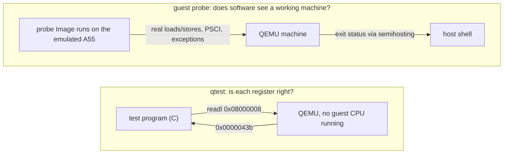

# Testing the model

This file shows how the model is checked: qtests on registers, a guest probe inside the machine, the acceptance run, and the device-tree check. Conventions and reading order: [`README.md`](README.md).

> **Context: milestone M1, the machine skeleton.** `-M rzv2l-smarc` with two Cortex-A55s, the GIC-600, DDR and the SYSC ID registers; nothing prints yet (the console is M2). Goal and exit criterion: [`../spec/project.md` §17](../spec/project.md#17-milestones). Everything tested here is M1's. The IDs used below are defined in the unit's files: acceptance criteria M1-AC01… in [`../units/M1-machine-skeleton/spec.md`](../units/M1-machine-skeleton/spec.md), the design in [`design.md`](../units/M1-machine-skeleton/design.md), tasks M1-T01–T08 with their mutations in [`tasks.md`](../units/M1-machine-skeleton/tasks.md).

Contents:
1. [qtest and guest probes](#1-qtest-and-guest-probes)
2. [A program inside the machine: the M1 probe](#2-a-program-inside-the-machine-the-m1-probe)
3. [The acceptance run: is M1 done?](#3-the-acceptance-run-is-m1-done)
4. [What QEMU does to a device tree you give it (M1-T07)](#4-what-qemu-does-to-a-device-tree-you-give-it-m1-t07)

---

## 1. qtest and guest probes

There are two methods to check a model. Each method answers a different question.

> "QTest is a device emulation testing framework. It can be very useful to test device models" (`qemu/docs/devel/testing/qtest.rst`)



- **qtest** (M1-T01 to T04) reads registers directly, with no guest code.
  - It is exact and fast.
  - It cannot see bus errors (see below).
  - It asserts the values from the **hardware manual**. It does not assert values copied from the output of the model (AGENTS.md rule 7).
- **The guest probe** (M1-T05, [§2](#2-a-program-inside-the-machine-the-m1-probe)) is a small program that runs *on* the emulated CPU. It checks what qtest cannot check:
  - the CPU IDs
  - the timer frequency
  - the exception level, and that the model has no EL2
  - PSCI `CPU_ON`
  - that an access to an unmapped address aborts

**Mutation check.** A test counts only after you have seen it fail. You change the model on purpose, and the test must become red:

| Mutation (M1-T01) | Test result |
|---|---|
| none | `ok /arm-gicv3/iidr/default`, `ok /arm-gicv3/iidr/property` |
| default changed `0x43b` → `0x43c` | `not ok …/default`: `(0x0000043c == 0x0000043b)` |
| GICR ignores the property | `not ok …/property`: `(0x0000043b == 0x0201743b)` |

The qtest of the machine (`qemu/tests/qtest/rzv2l-smarc-test.c`, M1-T04) checks T02–T04 together. It uses values from the manual and from the TRM:

| Test | Checks |
|---|---|
| `/rzv2l-smarc/sysc/id` | `DEVID` `0x18447447`, `PRR` `0`, `LSI_MODE` `0x10000`; a write to `DEVID` changes nothing |
| `/rzv2l-smarc/sysc/boot-pins` | `boot-mode=3` → `0x10003`; `debugen=on` → `0x10200` |
| `/rzv2l-smarc/sysc/boot-mode-reserved` | `boot-mode=6`: QEMU refuses to start, with "boot-mode 6 is reserved" (run in a child process, GLib `g_test_trap_subprocess`) |
| `/rzv2l-smarc/gic/layout` | `ITLinesNumber` 15, `LPIS` 0; `GICR_TYPER` affinity `0x0`/`0x100`, `Last` only on the second |
| `/rzv2l-smarc/gic/identity` | `GICD_IIDR`, both `GICR_IIDR` = `0x0201743B`; the 12 PIDR/CIDR bytes of GICD and both GICRs |

| Mutation (M1-T02 to T04) | Test result |
|---|---|
| `DEVID` `0x18447447` → `0x18447448` | `not ok …/sysc/id`: `(0x18447448 == 0x18447447)` |
| `STAT_DEBUGEN` on bit 8 | `not ok …/sysc/boot-pins`: `(0x00010100 == 0x00010200)` |
| CPU1 `mp-affinity` `0x100` → `0x1` | `not ok …/gic/layout`: `(0x00000001 == 0x00000100)` |
| `num-irq` 256, wiring unchanged | red, but QEMU aborts at start-up: the SoC wires a timer to GIC input 510, which no longer exists (`qemu/hw/core/gpio.c:108`). The assertion never ran. |
| 224 SPIs (`num-irq` 256), wiring consistent | `not ok …/gic/layout`: `(7 == 15)` |

The fourth row teaches a lesson: a red test is not always the *correct* red. In that row, QEMU stopped before the assertion ran. Only the fifth row shows that the `ITLinesNumber` assertion does its job.

**What qtest cannot see: bus errors.** qtest reads through the QEMU memory API and discards the result of the transaction (`qemu/system/qtest.c:555-569`). A failed read returns 0. Thus a qtest cannot tell "bus error" from "reads as zero", and the M1 qtest does not try.

The guest probe (M1-T05) checks the aborts in its place (AC13, AC14):
- an access to a SYSC offset that the model does not have
- an access to an unmapped address

In the probe, a real CPU must take the exception.

## 2. A program inside the machine: the M1 probe

The probe ([`tests/probes/m1-skeleton/`](../../tests/probes/m1-skeleton/), M1-T05) is approximately 300 lines of C and assembly. It runs *on* the emulated Cortex-A55s and checks what qtest cannot see. To run it, use [`tests/probes/m1-skeleton/run.sh`](../../tests/probes/m1-skeleton/run.sh):

```
M1 skeleton probe
PASS Image load address: 0x0000000048200000
-- CPU0
PASS MPIDR_EL1 affinity: 0x0000000000000000
PASS MIDR_EL1: 0x00000000412fd050
PASS CNTFRQ_EL0: 24000000
PASS CurrentEL: 1
PASS ID_AA64PFR0_EL1.EL2: 0
-- CPU1 via PSCI CPU_ON(0x100)
PASS CPU_ON return: 0
PASS CPU1 reported: 1
-- CPU1
PASS MPIDR_EL1 affinity: 0x0000000000000100
...
-- aborts
PASS unmapped 0x10000000 ESR.EC: 0x0000000000000025
PASS unmapped 0x10000000 DFSC: 0x0000000000000010
PASS SYSC offset 0x0 ESR.EC: 0x0000000000000025
PASS SYSC offset 0x0 DFSC: 0x0000000000000010
RESULT: PASS (0 failures)
```

**The probe looks like a Linux kernel.** The probe starts with the 64-byte arm64 Image header (`start.S:9-18`). QEMU sees the header and uses the same path as for a kernel:
1. It loads the image at `loader_start` + 2 MiB = `0x48200000` (header `text_offset` 0, `qemu/hw/arm/boot.c:858-870`).
2. It enters the image at EL1.
3. It answers PSCI over SMC ([`m1-machine-tour.md` §1.2](m1-machine-tour.md#12-reading-the-board-rzv2l-smarcc)).

The probe is linked at that address. It checks that QEMU loaded it at that address.

**Messages to the host: semihosting.** The machine has no UART yet. Thus the probe reports through *semihosting*. The instruction `HLT #0xF000` (`start.S:60`) asks QEMU to do an operation for the guest. Register `x0` holds the operation number, and `x1` holds a parameter. The probe uses two operations:

| Operation | Number | What QEMU does |
|---|---|---|
| `SYS_WRITE0` | `0x04` | prints a NUL-terminated string, to QEMU's **stderr** |
| `SYS_EXIT` | `0x18` | with the A64 parameter block {`0x20026` = application exit, status}, QEMU itself exits with that status (`qemu/semihosting/arm-compat-semi.c:751-772`) |

Thus the exit status of `qemu-system-aarch64` is the result of the probe. A shell script can check `$?`.

Semihosting is off unless you give `-semihosting-config enable=on`. It is a setting of the test run, not of the board. Without it, `HLT` is an undefined instruction.

**How the probe starts the second CPU.** At start, CPU1 is powered off ([`m1-machine-tour.md` §1.1](m1-machine-tour.md#11-reading-the-soc-r9a07g054c)). The probe calls PSCI `CPU_ON` in the same way as Linux (`probe.c:239`):
- `SMC #0`
- `x0` = `0xC4000003` (CPU_ON, 64-bit)
- `x1` = target affinity `0x100`
- `x2` = entry address

The built-in PSCI of QEMU powers on CPU1 at `secondary_entry` (`start.S:41`). CPU1 reads its own four values into a mailbox in RAM. CPU0 waits for the mailbox, with a timeout.

**How the probe catches an abort.** To prove that a read aborts, the probe installs its own exception vector table (`start.S:81`). This table is a 2 KiB block of 16 entries. On an exception, the CPU jumps to one of these entries. The handler (`probe.c:123`) reads `ESR_EL1`, the *Exception Syndrome Register*. This register tells what happened:

```
ESR_EL1 = 0x96000010
          ││     └┴─ DFSC [5:0] = 0x10: synchronous external abort (the bus said no)
          └┴──────── EC [31:26] = 0x25: data abort taken without changing EL
```

Note: the EL2 check asserts a choice of the model, not a value from the manual. The real Cortex-A55 has EL2 (fidelity gap 14 in [`docs/device-map.md` §4](../device-map.md#4-known-fidelity-gaps-req-guest-004-list-and-model-limits)). The check makes sure that the choice stays as recorded.

Note: the other bit that is set, bit 25, is IL. It means that the instruction that caused the fault has 32 bits. The QEMU log `-d int` shows the same value: `Taking exception 4 [Data Abort] … with ESR 0x25/0x96000010`.

The handler then adds 4 to `ELR_EL1` (the return address). Thus `eret` continues *after* the load that caused the fault (`probe.c:150`), and the probe continues. If the load completes, the handler caught nothing and the check fails. A placeholder that reads as zero causes exactly this failure.

The QEMU log shows the same reads with `-d unimp,guest_errors,invalid_mem`. `run.sh` keeps this log in `out/qemu.log`:

```
Invalid read at addr 0x10000000, size 4, region '(null)', reason: rejected   ← invalid_mem: hole
rzg2l_sysc_read: unimplemented read at offset 0x0                            ← unimp: SYSC default case
```

| Mutation (M1-T05) | Probe result |
|---|---|
| none | `RESULT: PASS (0 failures)`, exit 0 |
| SoC `cntfrq` 24 MHz → 62.5 MHz | `FAIL CNTFRQ_EL0: 62500000 (expected 24000000)` on both CPUs, exit 1 |
| zero-reading window at `0x10000000` (`create_unimplemented_device`, as imx8mp does for its holes) | `FAIL unmapped 0x10000000: read completed without an abort`, exit 1 |
| semihosting off | no output; `run.sh`: "no RESULT line … probe did not finish", exit 2 after its 20 s timeout |
| SoC `has_el2` false → true | `FAIL CurrentEL: 2 (expected 1)` and `FAIL ID_AA64PFR0_EL1.EL2: 2 (expected 0)` on both CPUs, then no RESULT line: exit 2 |

**A lesson from the last row.** The first version of the handler tried to *print* the exception that it did not expect. Printing executes `HLT` again, and `HLT` is undefined again. This is what happened:
1. The exceptions nested.
2. The stack went down through memory into the registers of the GIC.
3. `-d guest_errors` filled with stray GIC writes.

Now the handler parks the CPU if an exception occurs while it already handles one (`probe.c:128`). A test harness must also fail cleanly.

## 3. The acceptance run: is M1 done?

[`tests/acceptance/m1/run.sh`](../../tests/acceptance/m1/run.sh) (M1-T06) answers this question with one exit code. It combines the probe ([§2](#2-a-program-inside-the-machine-the-m1-probe)) with checks that only the full running machine can give:

```
== -M help
PASS -M help lists rzv2l-smarc
== info mtree -f
PASS mtree: 4 windows, nothing else
== info qtree
PASS qtree: 3 devices, 14 properties
== info roms
PASS roms: 2 blobs, none in 0x40000000-0x47ffffff
== dumpdtb with DTB-U
PASS dtb: 209 nodes; /memory@48000000 as expected; only /psci rewritten
== guest probe
RESULT: PASS (0 failures)
PASS probe exited 0
== log gate
PASS log: only the 2 allowed line(s)

M1 ACCEPTANCE: PASS
```

**The expected values come from the documents, not from QEMU.** The files in [`tests/acceptance/m1/expected/`](../../tests/acceptance/m1/expected/) come from [`docs/device-map.md`](../device-map.md). Each file tells which rows it comes from. If we copied the QEMU output into these files, they would prove only that the model did not change. They would not prove that the model is correct (AGENTS.md rule 7). Thus the form of each check follows what the documents state:

| Check | Match | Why that shape |
|---|---|---|
| `info mtree -f`, the flat view of the "memory" address space | **exact**: these 4 lines, nothing else | the device map gives every window's base and size; an extra window is a failure |
| `info qtree` | **exact device set**; per device, only the listed lines (base, size, `lsi-devid`, `num-irq`, `iidr` …) | QEMU prints internal properties (`force-8-bit-prio`, `first-cpu-index`) that no project document defines |
| `info roms` | a **rule**: every blob inside the Linux window `0x48000000`–`0xBFFFFFFF`, none in the firmware-reserved `0x40000000`–`0x47FFFFFF` | AC07; the exact blob list depends on the payload |
| `dumpdtb` with DTB-U | only the listed fixups differ from the stock DTB | AC08; [§4](#4-what-qemu-does-to-a-device-tree-you-give-it-m1-t07) |
| the probe | exit status 0 | [§2](#2-a-program-inside-the-machine-the-m1-probe) |
| `-d unimp,guest_errors,invalid_mem` log of the probe run | an **allow-list** of exactly the probe's two deliberate abort reads | anything else the guest touches is either modelled or listed (REQ-TEST-003) |

`info roms` lists what QEMU copies into guest memory at reset. With `-kernel`, the list has two items:
- the boot stub of QEMU, 40 bytes, at `0x48000000`
- the image, at `0x48200000`

| Mutation (M1-T06) | What fails |
|---|---|
| SYSC moved to `0x11030000` | mtree (diff printed), qtree (`missing 'mmio 0000000011020000/…'`), log (`Invalid read at addr 0x11020000`) |
| board `loader_start` → `0x40000000` | roms (boot stub and image overlap reserved DDR), probe (`Image load address: 0x40200000`) |
| SYSC logs one extra guest-error line | log gate only: `rzg2l_sysc_read: extra` |

**Why the checks go together.** If SYSC moves, the *probe still passes*. Its read of `0x11020000` aborts in both cases, because the address is now a hole. Only the memory map, the device list and the log gate see that the abort now comes from the wrong place. Each check has a blind spot. Together, the checks cover each other.

## 4. What QEMU does to a device tree you give it (M1-T07)

QEMU changes a device tree before the guest gets it. This section lists the changes and shows the check that finds them.

A device tree (DT) describes the board to Linux: which devices exist, at which addresses, with which interrupts. On the real EVK, U-Boot gives the DT to the kernel. In the direct-kernel mode of QEMU, `-dtb file.dtb` does this. QEMU does **not** give the file to the guest without changes. Before the first instruction runs, `arm_load_dtb()` (qemu v11.1.2 `hw/arm/boot.c`) edits the DT:

| Node | What QEMU does | Where | On our board |
|---|---|---|---|
| `/memory*` | blanks every memory node, then writes one from the board's `arm_boot_info` (`loader_start`, `ram_size`) | `boot.c:530-575` | `0x48000000` + `0x78000000`: the same as the stock DT, so the node comes out identical |
| `/chosen` | adds `bootargs` only with `-append`, `linux,initrd-start/end` only with `-initrd` | `boot.c:604-627` | neither is given in M1, so `/chosen` is untouched (the stock DT carries its own `bootargs`) |
| `/psci` | deletes the DT's node and writes its own whenever the board enables QEMU's built-in PSCI | `boot.c:366-401` | always: `rzv2l-smarc.c:60` sets the SMC conduit |

The guest gets the edited copy. The monitor command `dumpdtb <file>` writes out the same copy (`boot.c:643-645` stores it as the DT of the machine). Each edit is a difference from the real board. Thus each edit is on the REQ-GUEST-004 gap list ([`docs/device-map.md` §4](../device-map.md#4-known-fidelity-gaps-req-guest-004-list-and-model-limits), rows 7 and 8).

**The check.** [`tests/guests/g0/build-dtb.sh`](../../tests/guests/g0/build-dtb.sh) builds *DTB-U*: the stock `r9a07g054l2-smarc.dtb`, from the pinned G0 kernel (v6.12.59). The script gets only the DT sources. It then does the two kbuild commands:
1. the C preprocessor, for the `#include`s and the macros
2. `dtc`, with the kbuild flags

One of these flags is `-@`. It adds a `__symbols__` node, because an overlay can go on top of this DTB.

The acceptance run then does these steps:
1. It starts the paused machine with `-dtb DTB-U`.
2. It runs `dumpdtb`.
3. It decompiles both DTBs with `dtc -I dtb -O dts -s`. `-s` sorts the nodes, so their order cannot cause a difference.
4. It compares the two DTBs node by node:

```
== dumpdtb with DTB-U
PASS dtb: 209 nodes; /memory@48000000 as expected; only /psci rewritten
```

The `/psci` of QEMU is different from the stock node:

```
-		compatible = "arm,psci-1.0\0arm,psci-0.2";
+		compatible = "arm,psci-1.0\0arm,psci-0.2\0arm,psci";
+		cpu_off = <0x84000002>;
+		cpu_on = <0xc4000003>;
+		cpu_suspend = <0xc4000001>;
+		migrate = <0xc4000005>;
```

The extra properties are from the old PSCI 0.1 binding. Linux uses the 1.0 binding and ignores them. Thus the check lets QEMU change `/psci`, but `/psci` must keep `method = "smc"`. With `"hvc"`, Linux would call a hypervisor that this board does not have. The kernel runs at NS-EL1, and there is no EL2.

**Why the check compares `/memory` with a value.** QEMU gives its new node the same name and contents as the stock node. Thus a plain diff shows nothing. A plain diff tells only that the two nodes agree. It does not tell that the value is correct. Thus the check also compares the node with `0x48000000` + `0x78000000` from AC08.

| Mutation (M1-T07) | What fails |
|---|---|
| board `ram_size` 1 MiB smaller (`rzv2l-smarc.c:59`) | dtb only: `reg = <0x00 0x48000000 0x00 0x77f00000>` |
| (checker test) `/chosen/bootargs` edited | dtb: `/chosen differs` |
| (checker test) a node removed | dtb: `node /audio1-clk removed` |
| (checker test) `/psci` method `"hvc"` | dtb: `/psci lacks 'method = "smc";'` |

The `ram_size` mutation shows a blind spot again. The memory map, the ROM list and the probe all still pass, because here `ram_size` changes only the DT.

**Not covered:**
- the initrd fixup, because M1 gives no `-initrd`
- whether Linux boots with this DT. That is M3.
